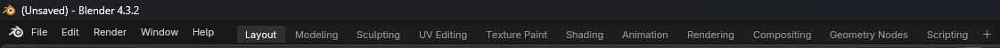
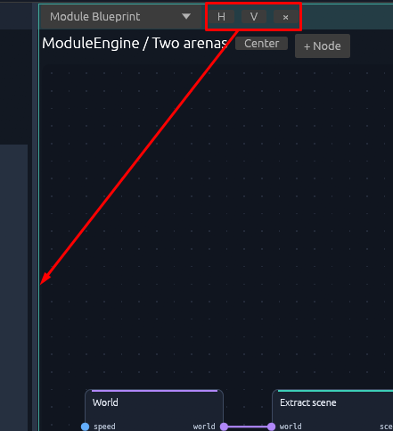
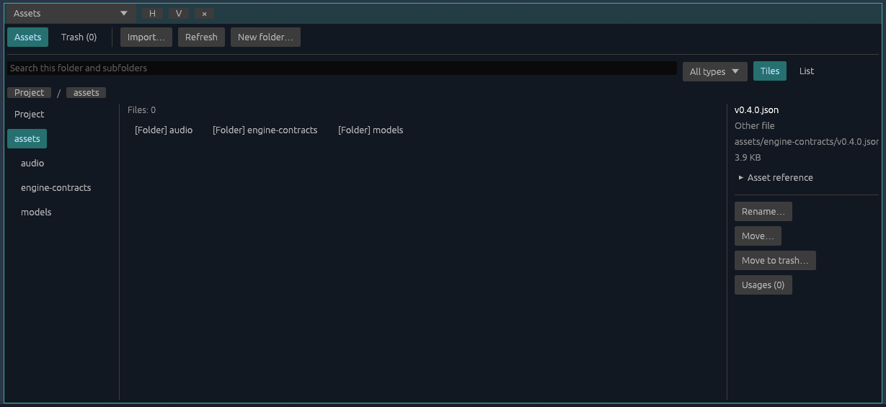

# Editor clarity: implementation plan

[English](editor-clarity-plan.md) | [Русский](ru/editor-clarity-plan.md) | [Documentation](README.md)

## Scope and order

On 13 November 2026 the user requested this plan to be saved and authorized
**stage 1, tasks 1.1–1.5 only**. The subsequent request authorizes **stage 2,
tasks 2.1–2.5**. One configurable ModuleEngine serves multiple
game projects. The [accepted direction](engine-composition-direction.md) defines
engine/game responsibility, the overview-first route and deferred multi-engine work.

Stages 1 and 2 are complete within their recorded verification/review scopes.
On 14 November the user requested implementation planning for the new UI.
The new [stage 2A](#stage-2a) precedes rendering work; on 15 November the user
authorized its implementation, now tracked in the [rollout record](editor-ui-rollout.md).
Existing stage numbers and anchors 1–6 remain unchanged. Execution order is
**1 → 2 → 2A → 3 → remaining stage-4 checks → 5 → 6**. The first complete
rendering route remains **Engine → understand composition → Rendering →
FXAA/off → apply → save/reopen**, now using the new UI foundation.
The subsequent 0.4.1 request authorizes stage 3, tasks 3.1–3.6; its
[implementation and scoped engineering evidence](release-041-verification.md)
are recorded separately, with human usability still unverified. Stages 4–6
remain planned work. Preserve authored data,
stable IDs, exact pins, personal layouts, existing sources and Full/Team rights.

The [UI/UX design](editor-ui-design.md), [technical baseline](editor-ui-spec.md)
and [supporting skills](editor-ui-skills.md) consolidate the later UI requests
and research. They do not implement or authorize deferred stages; exact metrics
are a proposed baseline, and unresolved product choices remain marked open.

The follow-up [complete UI catalogue](editor-ui-catalog.md) supplies a traced
inventory and per-surface requirements, states and layouts. Previously open
layout/window/address choices now have concrete proposed defaults for review;
the earlier queued notes remain the historical user agreement. This does not
authorize implementing stages 3–6 or change existing runtime acceptance.

## 1. Composition and responsibility

| Task | Work and completion condition |
| --- | --- |
| 1.1 | List actual installed modules, executable systems, services, libraries and editor tools from their existing sources. Record what is present and where it comes from. |
| 1.2 | Classify each capability as technical engine, reusable gameplay or a concrete project. Keep the capability's kind separate from its semantic owner; combat and health stay gameplay. |
| 1.3 | Supply a readable name, purpose, dependencies and configuration entry points for the current first-party capabilities. Do not invent behavior for an installed contract or library. |
| 1.4 | Define the evidence for installed, offered and participating states. Distinguish unknown evidence from a known empty set; authored selection is not proof of a running or ready instance. |
| 1.5 | Add missing source metadata alongside the current registries. Reuse their participation/availability rules; inspection is read-only and must not run factories, compile code or initialize services. |

Completion: every advertised current capability has a purpose and owner, a
traceable presence/participation source and an honest configuration route or
explicit limitation. Check smaller compositions, missing metadata and rejected
activity, absence of side effects and preservation of authored documents/pins.
Record the actual implementation/check/review status before closing this stage.

Stage-1 implementation and bounded verification are complete; see the
[capability contract and evidence](engine-capabilities.md#stage1-verification).
The independent review governs the reviewed source snapshot. This closes only
tasks 1.1–1.5; stage 2 is not started by that result.

## 2. Engine Overview

| Task | Work and completion condition |
| --- | --- |
| 2.1 | Add an overview pane reachable from Windows and the fresh default Engine layout; retain saved personal layouts. |
| 2.2 | Identify the current game/path, active configuration and actual editing rights. |
| 2.3 | Group technical subsystems and gameplay packages separately, using stage-1 evidence. |
| 2.4 | Show a selected capability's purpose, implementation, dependencies, state and supported actions. |
| 2.5 | Navigate to the actual relevant tool/graph, reusing an existing pane or opening one under the existing navigation rules. |

Completion: the user can locate the renderer, explain its role and open its
configuration without reading source. Check project changes, refresh of displayed
state, fresh/saved layouts, missing targets and Full/Team restrictions.

Tasks 2.1–2.5 are implemented. The [Overview contract and verification](engine-overview.md#stage2-verification)
record real window evidence, scoped regressions, preservation and the independent
source-bound conclusion. This does not start the rendering-control work of stage 3.

## 2A. Implement the new native editor UI

**Status: implementation delivered; bounded verification passed.** The user
requested stage 2A on 15 November. The [rollout record](editor-ui-rollout.md)
contains actual Windows/WSLg checks, matching delivery and independent review;
physical DPI/foreground/native-picker limits remain explicit. Stage 2's Overview
remains the behavioral baseline. This does not reopen capability work or start
stages 3/5/6; the deferred rendering/configuration/map routes remain deferred.

Goal: a user understands the project/configuration, finds a subsystem or object,
makes a permitted change, sees its actual result and can save/reopen it safely.
The deliverable is a working native Editor, not a viewer of the static mockups.

Use the [catalogue](editor-ui-catalog.md), [shared specification](editor-ui-spec.md),
[hierarchy prototypes](editor-ui-hierarchy.md), [command ownership](editor-ui-spec.md#command-ownership)
and [graph input](editor-ui-spec.md#graph) as the implementation baseline.
Prototype defaults remain explicit proposals: **+** duplicates the current
workspace after naming; rename/delete affect custom layouts; detach moves an
area and Close returns it; Assets address is selectable readonly text for the
same folder. Any adjustment must update the contract and mockup before its
implementation is accepted. Merely writing this plan does not accept a feature.

The first rollout targets the Windows Editor, preserves Linux buildability and
checks available existing Linux routes with their actual limits. New platform
services, mobile support and new hardware-Linux acceptance are outside this UI
stage; an unsupported picker must remain visibly unsupported.

### Package A — safe shared foundation

| Task | Result | Verification / dependency |
| --- | --- | --- |
| 2A.1 — scope and baseline | Build a coverage matrix from the existing 72 catalogue entries: current tool, actual command/owner/rights, proposed/deferred status, implementation task and evidence. Record the current Editor artifact, representative layouts, graph/Scene/Playing workloads and source availability. Do not count menus, native picker purposes or shared specimens as 72 new windows. | Use isolated projects and unchanged-content performance baselines. Validate complete Full fixtures and required-source inventories before tests; stale manifests must not be bypassed. No reset of the user's project/layouts. |
| 2A.2 — common visual primitives | Implement role-based spacing/type/surfaces, vector icons, fields, sections, selection/focus, disabled/busy states, semantic names, shortcut/reason help and overflow from the tokens. Separate readonly facts, editable values, drafts and origin. | Check actual controls at narrow widths and real DPI; no text shrinking, colour-only state or repeated card outlines. A library of controls must not initialize absent runtime services. Depends on 2A.1. |
| 2A.3 — shared commands and focus | Route toolbar/menu/shortcut equivalents to the same existing commands. Keep one persistent session controller in the main shell, separate Save and actual state-dependent Play/Pause/Stop/Restart. Remove Game and legacy Start/Pause duplicates; retain the distinct legacy Reset. Centralize input ownership before graph/overlay changes. | Verify same targets, availability and errors from each entry point; text/popups/modals/area borders take priority. No new independent preview clock, duplicated workers or synchronous simulation/GPU waits. Depends on 2A.1–2.2. |
| 2A.4 — Inspector draft safety | Repair the [known draft-cache lifecycle](editor-ui-hierarchy.md): bind drafts to document/scene/object/component and compatible schema/source, preserve other pending drafts after component Apply and preserve them across ordinary selection. Resolve project replacement, deletion or incompatible schema explicitly; unavailable Apply cannot be offered as a working choice. | Edit Actor and Health, apply one, select another object and return; other authored values and pending drafts survive. Check Apply/Discard/Cancel, Undo/Redo, Save/reopen and project isolation. No-op keeps prefab inheritance, exact null/unknown payloads and stable IDs. Existing guards alone are not evidence of this fix. Depends on 2A.1–2.3. |

### Package B — three reference screens

| Task | Result | Verification / dependency |
| --- | --- | --- |
| 2A.5 — Engine Overview | Apply P01's group/list/detail hierarchy, marked selection, one contextual primary route and compact drill-down. Keep actual installed/offered/participating evidence, unknown states and runtime-readiness limits. | Find the selected renderer and reach its exact existing graph without changing the document or launching factories. Full/Team/missing-source behavior stays valid. Depends on package A. |
| 2A.6 — Inspector | Apply P08's object/prefab context, bounded Transform fields, source-owned component sections, origin/draft labels and component-local Apply. | Use the repaired 2A.4 lifecycle; inspect wide/480-point/short panes, schema/reference fields, prefab no-op, missing schema and Play restrictions. No fake aggregate Apply. Depends on 2A.4 and 2A.2. |
| 2A.7 — Assets | Apply P09's folder tree, type icons, scoped recursive search, results/selection/detail regions and readonly address/breadcrumb modes. Keep file operations explicit and selected-ID scoped. | Import/drop/preview; rename/move/trash/restore and usages; protected paths, save-first guard, replacement/detach, Undo and errors. Copy path/reference must preserve their distinct meanings. Browsing never edits files. Depends on package A. |

**First visual checkpoint:** these three real areas establish the common
hierarchy before the rest of the editor is restyled. Review the rendered UI,
not just tokens or SVG similarity. Revise remaining old catalogue layouts as
needed to follow these principles; do not mechanically copy their old monotony.

### Package C — shell, layouts and native windows

| Task | Result | Verification / dependency |
| --- | --- | --- |
| 2A.8 — shell and workspaces | Arrange File/Edit/Tools/Windows, project identity/path/rights, session controls and Save; group window entries. Add named Engine/Project/custom tabs, **+**, custom rename/delete and scoped reset using the documented defaults. Keep backward-compatible personal layout storage separate from the authored project format. Open/Recent keep their guarded command routes. | Existing personal layouts load without silent reset; tabs change layout, not document or rights. Add/switch/save/restart custom layouts, long names, overflow and Cancel. Tab drag-reordering is not required by this slice. Depends on packages A–B. |
| 2A.9 — area management | Replace H/V/× with readable border-RMB split/join actions and a keyboard-accessible header equivalent. Preview the retained neighbor and make cancellation safe. | Border versus graph targeting, both split directions, survivor identity, last-area fallback, saved area IDs and personal view state. A split/join does not become authored Undo or dirty the game. Depends on 2A.8. |
| 2A.10 — separate OS windows | First check the current window/render integration, then implement real native area detachment: move the area, share one document/history/session, preserve per-view state, close only that instance; explicit Return uses a safe fallback if its slot changed. | Actual second OS window, focus/input, shared edits/Undo, close/return/restart, monitor removal and mixed DPI. No floating-panel substitute or forked project/simulation. Registered tools follow their real host/state lifecycle. The persistent controller stays in the main shell; secondary shortcuts route to the same commands; the client area header replaces secondary File/Edit, while OS title/name/× and native resize frames remain stable. Depends on 2A.3 and 2A.9. |

### Package D — graphs, Scene and Game

| Task | Result | Verification / dependency |
| --- | --- | --- |
| 2A.11 — graph input | Implement the agreed scope-aware gestures: MMB/RMB drag pan, plain wheel at pointer, RMB Add/actions, eligible-node double-click into an existing subgraph, F framing, Alt+LMB wire deletion and mixed Delete as one Undo. Root Blueprint has no permanent Add/Open/Frame/Delete row. Provide the documented keyboard menu equivalent. | Click/drag threshold, release after pan, pins/embedded fields, focused-canvas F/Delete versus text, modal/border priority, selection, cleanup/Undo, nested scopes and Full/Team. Apply only supported commands to GPU/gameplay/Rust contexts; no arbitrary Rust AST editing. Depends on 2A.3 and 2A.9. |
| 2A.12 — library and node help | Restyle the real scope-filtered module/system palettes and node/resource inspectors. Replace the permanent PIN CONTRACTS footer with connection-local help and optional type reference. | Add only compatible permitted descriptors into the original target scope; explain mismatches and preserve last-good connections. No fake unavailable nodes or compilation on search/selection/pan. Depends on 2A.11. |
| 2A.13 — Scene and Hierarchy | Put transform tools in the edge rail and coordinate/snap/frame options in compact overlays; keep shared authored-object selection with Hierarchy/Inspector. | Overlay capture prevents picking through; move/rotate/scale, world/local/snap, one gesture/one Undo, Escape/focus loss, narrow/short view and Save/reopen. Keep Scene authoring separate from Game and legacy views. Depends on package B and 2A.9. |
| 2A.14 — Game and legacy areas | Use shell session commands and viewport-specific Game tools/status. Group and label legacy runtime views; retain existing serialized area types and supported legacy Reset/configuration. | Play/Pause/Restart/Stop, focus/input and author/Play-copy separation; root-preview shared playing state, no duplicate controller; old layouts/documents reopen. Depends on 2A.3, 2A.8 and 2A.13. |

### Package E — complete the existing editor surface coverage

| Task | Result | Verification / dependency |
| --- | --- | --- |
| 2A.15 — remaining real tools | Apply shared components and task hierarchy to existing Engine exposure, Project settings, Gameplay Systems, Rust/HLSL, Project File, History/Merge, Diagnostics, Participating Modules and registered game tools. Keep partial Rust visual coverage, opaque fragments, source/slot state and tool ownership explicit. | Every current tool in the coverage matrix has a real reachable command/result or honest availability reason. Save versus Apply, exact JSON, scope/history, source pins and absent capabilities remain valid. Project-specific G1 tools do not become universal engine mechanics. Depends on packages A–D. |
| 2A.16 — dialogs and transitions | Integrate current modal/merge/recovery forms, workspace dialogs and operation feedback. Native file pickers stay OS-owned; preserve adapter/filter/Cancel semantics. Resolve hidden tool/component drafts before guarded destructive transitions. | Dirty project and multiple drafts, Save As/Open/Recent/close/export, invalid JSON/migration, cancellation/failure/recovery and shared-window modal focus. No second active background controller or successful-looking unsupported picker. Depends on 2A.4, 2A.8–2A.10 and 2A.15. |

### Package F — verify and deliver

| Task | Result | Verification / dependency |
| --- | --- | --- |
| 2A.17 — feedback and responsiveness | Use real preparing/applying/ready/error state, last-good provenance and actionable diagnostics. Compare idle, graph drag/zoom, Scene edits and Playing against 2A.1; remove measured UI regressions without redesigning render algorithms. | Same content/features/resolution/machine conditions, recorded callback/frame distributions and workload. No compile/rebuild on navigation, fake percentages, inactive Cancel or synchronous GPU/Custom waits. Existing G1/ARPG/render budgets are unchanged; noisy/offscreen results are not substituted for required acceptance. Depends on implemented packages A–E. |
| 2A.18 — acceptance, documentation and delivery | Close the matrix with actual native evidence, appropriate regression checks, full EN/RU docs and independent review at HEAD/source digest. Produce a matching Editor/source package and verify ordinary startup/source availability; user must not receive an old EXE or stale Full manifest. | Windows Full/Team/source-missing/omitted-module routes, fresh/saved layouts, project/draft isolation, native windows, error/Cancel/Undo/Save/reopen. Inspect 1280×720/1600×900/1920×1080 work areas at 100/150/200%, long values and narrow/short areas. Linux compilation and available native routes are separate evidence; missing Linux picker/hardware coverage is not relabelled a pass. Run native/GPU jobs sequentially, fix/review findings, and preserve Player feature scope. No publication is implied. Depends on 2A.17 and all required matrix rows. |

**Order and completion gates:** A → B → C → D → E → F. A task is complete only
after its concrete behavior, rejection/Cancel paths and dependencies are checked;
a screenshot, hidden control or successful build alone is insufficient. The
first implementation request can target **2A.1–2A.4**, then the three-screen
checkpoint **2A.5–2A.7**. This plan does not start either package automatically.
Update complete EN/RU contracts and perform scoped independent review before
closing each substantial implementation package. The final integrated check
in 2A.18 does not replace those intermediate checks.

### Follow-up — separate scenes, then Hierarchy (15 November 2026)

The user's selected order is source storage first, then navigation. The contract
and bounded verification are in [scene files](scene-files.md): Core hydrated
scenes/names, versioned ProjectTools source IO, Editor/File/Assets history and
Full/Team/Player projection. Hierarchy follows with full-width collapsible rows,
search, names/F2 and one object Undo. Ordinary Open/Save retains inline projects;
New/Save As/explicit conversion writes external files. Preserve authored/personal
data. Acceptance requires error/Cancel/no-op/Undo/Save/reopen, copy independence,
package relocation, native geometry and independent review. This follow-up does
not begin stage 3 or G2.

### Boundaries with the old stages

| Catalogue / old work | Ownership of remaining implementation |
| --- | --- |
| Current areas, views, dialogs, menus and C01–C04 control families | Stage 2A covers their real UI and guards. Specimens/native-picker purposes are not extra bespoke OS windows. Unknown future P22 panels must register their own real UI; no invented plugin is required. |
| V02 rendering configuration and D11 preset replacement | Stage 3 owns the missing render/exposure semantics and actual image agreement. 2A styles existing controls and provides real existing navigation only; no decorative AA choice or unimplemented preset command. |
| V10 architecture map | Stage 6. A style contract or catalogue entry is not a completed map or a working navigation target. |
| Input/audio/world/gameplay capability configuration routes | Stage 5 extends real discovery/configuration. 2A must not invent a configuration API for a library or enable an absent service. |
| New gameplay/render subsystems, full visual Rust, G2 animation/AI editors, game HUD/art, mobile ports, multi-engine management | Outside 2A; original roadmap/decisions remain in force. This is editor adoption, not permission to add these features. |

Do not implement old stage 4 twice. Its stable task IDs remain traceable:

| Old task | Reuse actual stage-2A evidence; check any remaining gap |
| --- | --- |
| 4.1 Scene versus Game | 2A.3, 2A.13–2A.14, 2A.18. |
| 4.2 Legacy identities/layouts | 2A.9–2A.10, 2A.14–2A.15, 2A.18. |
| 4.3 Windows menu grouping | 2A.8, 2A.15, 2A.18. |
| 4.4 Project/Open/Recent access | 2A.8, 2A.16, 2A.18. |
| 4.5 Unsaved/Cancel/error transitions | 2A.4, 2A.16, 2A.18. |

These mappings do not mark stage 4 complete today. After 2A, and when stage 4 is
reached, reconcile source/artifact-bound evidence and finish only uncovered
criteria. The queued notes below retain historical user requests; latest
catalogue/spec defaults and this stage govern the implementation proposal.

## 3. Complete rendering configuration route

This is the first milestone in the [product roadmap](product-roadmap.md#render).
Use the [0.4.1 brief](release-041-plan.md) for the two author roles, ordinary launch,
standalone Player evidence and implementation handoff.

Implementation and bounded engineering checks are recorded in the
[0.4.1 report](release-041-verification.md). Owner and independent-author
usability acceptance remains open; these checks do not start stages 4–6.

| Task | Work and completion condition |
| --- | --- |
| 3.1 | Show the selected render path and existing passes with plain explanations of AO, AA and other abbreviations. |
| 3.2 | Distinguish Engine architecture/exposure from the values and ready variants Project may change. |
| 3.3 | Complete existing FXAA/off selection first: authored settings and the actual image must agree. |
| 3.4 | Keep panel and graph consistent when AA/AO is removed or restored; distinguish an absent pass from a disabled effect. |
| 3.5 | Report actual changed/applying/ready/error states and required Stop or rebuild before execution. Rejection retains the accepted version. |
| 3.6 | Verify image change, Undo/Redo, Save and reopening, plus rejected candidates and relevant existing render paths. |

Completion: AA can be understood, changed, observed and restored from disk.
Use real rendered evidence where image behavior is claimed; data-only tests do
not replace it. Existing performance criteria apply when runtime changes.

## 4. Windows and project navigation

| Task | Work and completion condition |
| --- | --- |
| 4.1 | Make Scene authoring and Game/Play responsibilities clear. |
| 4.2 | Explain and group similar legacy windows without breaking old documents, serialized area identities or saved layouts. |
| 4.3 | Group Windows entries by scene, resources, gameplay, Engine configuration and diagnostics. |
| 4.4 | Make the current project and Open/Recent access visible through the existing guarded commands. |
| 4.5 | Check unsaved transitions, Cancel, opening errors and refresh after changing games. |

Completion: each window's data scope and the route to another game are clear.
Gameplay ownership does not automatically grant permission to edit a frozen
Team schedule. One game must not inherit another game's unsaved state.

### Queued UI improvement: named workspace tabs — 14 November 2026

The user requested a Blender-style top strip of named workspaces/layouts and
explicitly deferred implementation while collecting UI improvements.
Record this as an addition to stage 4; the current UI is unchanged.

- Show the available named layouts as tabs across the top, following the reference below.
- Treat Engine and Project as initial workspace presets; allow adding a custom
  named layout through a visible **+** control.
- Each layout retains its own arrangement and window types. Save custom layouts
  as personal editor settings, preserving existing saved layouts.
- Switching layouts keeps the same open game document. A layout name does not
  grant Engine editing rights or change the existing Full/Team restrictions.

The exact new-layout flow (blank layout, duplicate or preset selection) and any
rename/reorder/delete controls have not been agreed yet. They are not added to
the implementation scope by this note.

Future acceptance: add a named layout with **+**, arrange its windows, switch
between it and the presets, and restore the saved layouts without changing
the project, permissions or existing personal arrangements.

### Queued UI improvement: area-border menu and external windows — 14 November 2026

Keep collecting requirements; implementation remains deferred. Move access to
the current **H / V / ×** area-management functions to a context menu opened by
**right-clicking the border between areas**. Use readable commands for horizontal
split, vertical split and closing/joining neighboring areas, with a clear choice
of which area's contents survive. The final treatment of redundant header buttons
is not yet specified.

Reference checked against the [official Blender 4.3 area manual](https://docs.blender.org/manual/en/4.3/interface/window_system/areas.html):
right-clicking a border offers splitting, joining and swapping. Its **Duplicate
Area into New Window** command creates another native window in the same Blender
instance; the original area remains. It is also available by Shift-dragging an
area corner. Swapping is reference behavior, not an additional agreed requirement.

The requested ModuleEngine capability is an editor panel in a **separate native
OS window**, usable on another monitor. All such windows share the same open
project, authoring state/history and existing editing permissions. Preserve each
panel's viewing/navigation state and provide a way back to the main layout.
Whether the primary command moves the original area or creates an additional
view, and the exact return/close behavior, remain decisions for implementation;
do not silently equate detaching with Blender's duplication.

Future acceptance: border-menu targeting, both split directions, neighboring-area
closure/joining, cancellation and saved layouts; external-window editing/focus,
shared changes and undo, another monitor, return/close, and Full/Team boundaries.
No native-window support or changed header controls are implemented by this note.

### Queued UI improvement: graph mouse controls — 14 November 2026

Record the user's final correction: panning uses **MMB or RMB dragging**, not
LMB. The earlier suggestion to allow only MMB was superseded. Keep ordinary
LMB node selection/dragging separate from moving the graph view.

| Gesture inside the graph | Requested behavior |
| --- | --- |
| Alt + LMB on a connection | Delete that connection. |
| MMB drag or RMB drag | Pan the graph view. |
| RMB click on graph background without dragging | Open the available-node list for that graph's current scope. |
| RMB click on a node without dragging | Open that node's available-actions menu. |
| Mouse wheel without Ctrl | Zoom the graph around the cursor. |
| Delete with nodes/connections selected | Delete the complete selection. |

Distinguish an RMB click from a drag with the normal drag threshold; releasing
after panning must not open the node list. RMB on an **area border** instead
opens the area-management menu described above. Node lists retain current
graph/scope and Full/Team availability rules. Connection deletion participates
in existing Undo/Redo and validation; zoom/pan stay local to the hovered graph.

Add multi-selection of nodes and connections, including a mixed selection.
Delete removes the selected nodes/connections and incident wires of removed
nodes without leaving dangling endpoints. Use one Undo/Redo transaction for
the batch, including existing associated-settings cleanup and validation.
Only the focused graph handles this command; Delete in a text field edits text.
Node actions depend on node type, supported operations and current permissions;
do not offer decorative or inapplicable commands. Node-context clicks refine
the background node-list gesture; ordinary LMB still selects/drags nodes.

Future acceptance: distinguish click/drag, delete and undo a wire, add a node to
the correct scope, zoom without Ctrl and preserve the point under the cursor;
other panes, text inputs, node dragging and border controls keep their own input.
Also verify node-specific actions, mixed selection, batch deletion and complete
Undo restoration without affecting another scope or an active text field.
These are planned bindings; the current implementation is unchanged.

### Queued UI improvement: readable Assets browser — 14 November 2026

Use Unity's Project browser as a visual/navigation reference. The user highlighted
two concrete shortcomings in the current Assets window: the path cannot be
selected as a text address, and folders look like plain labels rather than folders.
Implementation remains deferred while collecting UI improvements.

- Retain clickable breadcrumb segments, and provide the same location as a
  selectable/copyable text path. These are two views of one current folder.
- Make folders recognizable by folder icons in the tree, Tiles and List modes.
  Tile entries need an actual folder pictogram with its name rather than just a
  `[Folder]` text prefix; the tree needs clear indentation and expand/collapse state.
  Do not rely on color alone to distinguish folders from files.
- Preserve current browsing, search/filter, preview, import, stable asset IDs,
  references and file-operation safeguards. This is a presentation/navigation
  improvement, not a new asset format or resource-root change.

The [official Unity Project window reference](https://docs.unity3d.com/6000.0/Documentation/Manual/ProjectView.html)
documents its folder tree and type-specific icons. Selectable/copyable address
text is the user's requested behavior; no particular Unity shortcut is assumed.
The text/breadcrumb switching gesture, relative/absolute address format and
manual path entry have not yet been specified.

Future acceptance: identify folders at a glance, navigate using breadcrumbs,
select/copy the same current location as text and switch folders without losing
selection/reference integrity or changing files just by browsing.

### Queued UI improvement: Scene overlays and standard icons — 14 November 2026

The user requested tools distributed at viewport edges or in floating groups,
and recognizable icons with hover help for standard tools/controls, including
Play, Stop and Save. Record these requirements without changing the editor.

- Scene: edge transform tools and compact overlay groups for coordinate space,
  snapping and framing, with responsive overflow and no input leaking into the
  scene. Preserve existing shortcuts and gesture/Undo/Cancel behavior.
- Standard actions use icons, persistent selected/checked states and tooltips
  with the real shortcut, effect and disabled reason. Keyboard focus and semantic
  names provide equivalent access. Module names and ambiguous/destructive choices
  retain text; icon-only is not a rule for every command.
- Replace the unexplained permanent `PIN CONTRACTS` library footer with contextual
  connection help and optional type reference; preserve real pin validation.

The [design](editor-ui-design.md#interaction) and
[technical spec](editor-ui-spec.md#scene) define rationale, proposed dimensions,
states and acceptance checks. They also distinguish the current legacy 3D
Viewport's document-mutating presets from harmless view settings. No relocation,
native window or icon/overlay implementation is accepted by this note.

## 5. Extend the route to other existing capabilities

| Task | Work and completion condition |
| --- | --- |
| 5.1 | Connect existing input capabilities and action configuration; keep game action meaning separately owned. |
| 5.2 | Connect audio configuration while distinguishing the native service from game files, cue mappings and volume policy. |
| 5.3 | Connect resource/import and world tools, with actual supported paths and compatibility limits. |
| 5.4 | Connect gameplay-system and package-tool entry points with correct ownership and editing rights. |
| 5.5 | Check omitted optional capabilities: no implicit services, unrelated required settings or unwanted game-delivery features. |

Completion: existing capabilities have the same understandable discovery route,
with actions appropriate to libraries, services and executable systems. This
stage does not add missing animation, networking, physics or backend subsystems.

## 6. Useful architecture map

| Task | Work and completion condition |
| --- | --- |
| 6.1 | Select concrete questions for the map: dependencies and consequences of removing a capability. |
| 6.2 | Derive nodes/relationships from actual composition metadata, preserving ownership and unknown-state distinctions. |
| 6.3 | Start with relationship inspection; a read-only first version is the recommendation, not an implemented editor. |
| 6.4 | Open the same details/tools as the overview, without independent configuration state. |
| 6.5 | Verify usefulness, agreement with the selected configuration and responsiveness. |

Completion: the map answers the selected questions and supplements the overview.
It does not turn every helper/service into an executable node or imply a
universal scheduler. Reassess its usefulness after the preceding routes work.

## Completion rules for every stage

Implement bounded tasks, verify actual behavior and relevant failure/cancellation
paths, update full English/Russian documentation, and obtain independent review
with a HEAD/source-digest binding. Fix confirmed in-scope findings and recheck the
affected scope. Record remaining limits explicitly.

Choose checks from the [verification routes](verification.md), inspecting
`--plan` first; use focused regressions rather than repeating the full suite for
every small edit. Run native/GPU/timing checks sequentially. Recheck affected G1,
ARPG and Puzzle consumers as appropriate. Use isolated fixtures and brief native
UI sessions only where real UI observation is needed.
