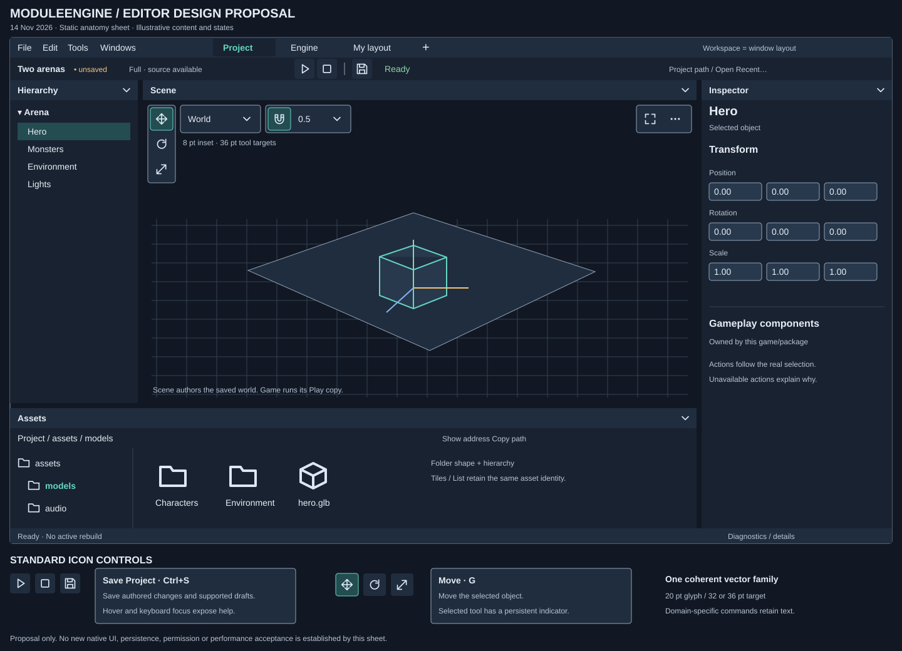

# Editor UI/UX design

[English](editor-ui-design.md) | [Русский](ru/editor-ui-design.md) | [Documentation](README.md)

## Status and authority

Design baseline dated **14 November 2026**. This document records the user's
requests, a source audit and primary-source research. It proposes a coherent
interface; it **does not implement it**. The [technical specification](editor-ui-spec.md)
and [tokens](editor-ui-tokens.json) describe proposed measurements, not the
currently shipped editor. The [clarity plan](editor-clarity-plan.md) remains the
implementation order: stages 1–2 are implemented within their evidence;
[stage 2A](editor-clarity-plan.md#stage-2a) is now being implemented under the
15 November request; [actual adoption and evidence](editor-ui-rollout.md) are
recorded separately. Stages 3–6 remain pending. The design itself is not native
UI acceptance.

Authority order: the user's latest instruction, project preservation and rights
contracts, accepted direction, this design and its technical baseline. When a
proposal needs a new product decision, keep it marked as proposed. Reference
applications inform the design; their shortcuts and persistence rules are not
automatically ModuleEngine requirements.

Goal: a user can understand the selected engine composition, open its real
configuration, make a permitted change and explain its current state. A clear
Scene authoring route must coexist with that task. Non-goals: another engine
catalogue, new rendering/gameplay features, project-format changes, or a cosmetic
reskin that leaves controls misleading or nonfunctional.

The [complete surface catalogue](editor-ui-catalog.md) extends this baseline
with the source inventory, per-window/dialog requirements and states, and a
separate layout/state sheet for every entry. Use it for the specific surface;
this document remains the shared rationale, not a claim that one anatomy sketch
specified every window.

The subsequent [visual hierarchy refinement](editor-ui-hierarchy.md) revises
only P01 Overview, P08 Inspector and P09 Assets. It separates navigation,
selection, a contextual primary action and supporting facts, with compact-area
variants. Source/link/contrast completeness alone is insufficient to establish
task clarity. Other catalogue layouts have not received this visual refinement.

The [control-ownership audit](editor-ui-spec.md#command-ownership) removes the
Game lifecycle and Project File Save duplicates. A shared toolbar owns
Game-session controls; panes keep distinct view/draft operations. Legacy
preview retains only its scoped Reset/configuration; its Start/Pause shares
the shell flag and is removed. Explanatory specimens have explicit sample scope.
Menu/shortcut alternatives remain supported. This is a mockup correction.

Root Blueprint now omits the persistent Add/Open/Frame/Delete row in its
mockup. Background RMB, eligible-node double-click, canvas-focused F/Delete
and contextual menu equivalents provide the same operations; text/popup focus
keeps priority. These target bindings are not a native implementation change.

## Information architecture

One configurable ModuleEngine serves multiple game projects. Keep these concepts
separate throughout the interface:

| Concept | Meaning and visible cue |
| --- | --- |
| Open game project | The authored document, resources and game rules. Show its name, dirty state and accessible full path. File → Open/Recent changes it through existing guards. |
| Engine configuration | Technical composition and the changes Project may make in this document. It is not a global update to every game. |
| Workspace | A named arrangement of editor areas. Engine and Project are starting layouts; changing tabs keeps the same document and permissions. |
| Tool/graph scope | What this view edits: rendering passes, gameplay schedule, authored scene or the legacy root blueprint. Show the scope by name and breadcrumb. |
| Capability owner | Technical Engine, reusable Gameplay or a concrete Project. Combat/health are gameplay; a rendering backend is technical Engine. |
| Editing rights | Actual Full/Team and source availability rules. A workspace name never grants or removes rights. A frozen Team schedule stays frozen even when its owner is Gameplay. |

The main composition route is **Engine Overview → subsystem details → supported
tool**. Graphs explain and edit a specific process. The architecture map is a
secondary relationship view, not a requirement to wire every service or library
as an executable node. Preserve installed/offered/participating distinctions
and unknown evidence from the [capability contract](engine-capabilities.md).

The Overview should group technical subsystems separately from gameplay
packages/project content, show purpose and current evidence, and provide one
honest configuration route. Display unavailable actions with a reason where
they help discovery. Do not display network settings when the selected
composition lacks a network capability. Optional capabilities must not activate
just because a panel was opened.

## Current problems and design responses

These observations concern current source and the user's screenshots, not a new
runtime acceptance run. Relevant sources are listed in the technical spec.

| Observed interface | Why it is confusing | Proposed response |
| --- | --- | --- |
| Engine and Project offer many of the same windows. | Layout names look like separate documents or permission modes. | Keep them as named workspace presets; show document identity and actual rights separately. |
| Module Library repeats “Modules”, shows a raw pane number, a long stack of full-width add buttons and `PIN CONTRACTS` below a height-limited list. | It mixes catalogue, target identity and technical help; the lower content can be clipped. | Searchable scoped catalogue, readable destination, list rows, contextual help and one scrollable content region. |
| `PIN CONTRACTS` is a coloured type legend. | The term is unexplained and detached from the attempted connection. | Pin tooltips/details explain data meaning; invalid connections explain the actual incompatibility. An optional “Connection types” help section provides the full legend. |
| Legacy 3D Viewport offers Objects/ECS and GPU Forward/Deferred beside a demo. | A view looks like a second authority for architecture. | Show the current configuration and navigation; move preset replacement to an explicit graph/configuration action in a later implementation. |
| Scene has a long textual tool row. | Actions/settings consume permanent space and compete with content. | Edge tool rail and compact overlay groups, with clear active state and overflow. |
| Play, Stop, Save and transform tools use textual buttons. | Standard frequent controls are visually bulky. | Recognizable vector icons with tooltips, accessible names and menu equivalents. Keep domain-specific commands labelled. |
| H/V/× appear in every area header. | Single letters do not explain layout operations. | Area-border context menu with readable split/join commands; retain a discoverable header menu/keyboard route. |
| Assets folders look like `[Folder] name` text. | Folder/file distinction and hierarchy are weak. | Folder pictograms, tree disclosure/indentation and type icons; breadcrumbs and a selectable address for the same location. |

`PIN CONTRACTS` means **contracts of pins/connections**, not “Pin constructs”.
The current legend describes root types (`World`, `Scene3D`, `Frame3D`, `Scalar`)
and GPU types (`GpuColor`, `GpuNormals`, `GpuDepth`, etc.). It is not the actual
validator. Equal-looking pin colours or broad “texture” labels are insufficient:
the real contract may also constrain meaning, format, dimensions or sample count.
Do not discard that information to simplify the visible label.

The legacy preview buttons currently **edit the root document**. Selecting a GPU
preset replaces the selected renderer's subgraph; it is not a harmless temporary
camera setting. Any later relocation must preserve old documents/window IDs and
make destructive replacement and Undo explicit. Removal/renaming of that view
has not been approved by this design request.

## Reference research and conclusions

Primary documentation consulted on 14 November 2026. These are bounded pattern
comparisons, not usability tests or copied pixel measurements.

| Reference and observed pattern | Application to ModuleEngine | Limit |
| --- | --- | --- |
| [Blender 4.3 Workspaces](https://docs.blender.org/manual/en/4.3/interface/window_system/workspaces.html): top tabs represent task-oriented area layouts; a + control adds a workspace. | Named tabs and a visible add action make layout switching understandable. | Blender can save workspace data in its document; ModuleEngine retains personal editor layout storage and its own project guards. |
| [Blender 4.3 Areas](https://docs.blender.org/manual/en/4.3/interface/window_system/areas.html): border context actions manage splitting/joining; “Duplicate Area into New Window” creates another window in the same instance. | Put layout operations at borders and support a real secondary OS window. | Blender duplication is not detaching/moving the original area. ModuleEngine's exact move/duplicate policy remains open. |
| [Unity 6.0 Project window](https://docs.unity.com/en-us/engine/6000.0/manual/unity-editor/editor-windows-views-reference/project-view): folder hierarchy and type-specific asset icons support browsing. | Folder pictograms, tree structure and consistent Tiles/List identities. | Selectable address text is the user's requirement; this source does not establish its exact gesture. |
| [Unity 6.0 Overlays](https://docs.unity.com/en-us/engine/6000.0/manual/working-with-scenes/scenes-manage-gameobjects/overlays): Scene tools live in configurable panels/toolbars with contextual information. | Group Scene tools close to the viewport and avoid one large settings row. | Arbitrary draggable overlay customization is not required by the initial baseline. |
| [Unreal 5.6 Viewport Toolbar](https://dev.epicgames.com/documentation/en-us/unreal-engine/viewport-toolbar?application_version=5.6): grouped transform/snap/camera controls and overflow for smaller viewports. | Stable tool locations, grouped settings and explicit overflow. | Unreal documents a toolbar above the viewport. Our floating/edge arrangement is a design choice, not an identical copy. |
| [Unreal Blueprint Graph Editor](https://dev.epicgames.com/documentation/unreal-engine/graph-editor-for-the-blueprints-visual-scripting-editor-in-unreal-engine): RMB drag pans, wheel zooms and a click opens a context menu. [Node placement](https://dev.epicgames.com/documentation/unreal-engine/placing-nodes-in-unreal-engine?lang=en-US) uses contextual search. | A familiar graph input pattern and catalogue filtered by the current scope. | Keep the user's final MMB-or-RMB panning and Alt+LMB **wire** deletion; do not import Unreal's Alt-click-pin semantics. |

These patterns support a consistent hypothesis: stable layout, context-specific
tools and progressive disclosure should reduce the current ambiguity. They do
not prove that a proposed screen is usable. Test the actual task route before
accepting implementation; shorten the route or revise labels when users still
cannot explain what they are changing.

For our internal readability benchmark use [W3C text contrast](https://www.w3.org/WAI/WCAG22/Understanding/contrast-minimum.html),
[non-text contrast](https://www.w3.org/WAI/WCAG22/Understanding/non-text-contrast.html)
and [hover/focus guidance](https://www.w3.org/WAI/WCAG22/Understanding/content-on-hover-or-focus.html).
The spec defines the adapted thresholds. This is not a claim of WCAG conformance
for a native desktop application.

## Interaction and content rules

**Icons.** Play/Pause, Stop, Save, Move, Rotate, Scale, framing and snapping are
standard controls: use one coherent vector family with recognisable shapes.
Tooltips name the action, current shortcut if assigned, effect and unavailable
reason. Selected tools need a persistent checked/active indicator. Keyboard
focus exposes equivalent help; every icon has a semantic accessible name.
Keep readable labels in menus. Module names, graph types, Apply/rebuild/export
choices and destructive confirmations need text; replacing every word with an
icon would make discovery worse. Do not add decorative commands without behavior.

**Scene.** Put transforms in a left edge rail; coordinate space and snap options
in compact groups near the top; framing at the top right. They are overlays over
the image, not additional scene objects. They consume their pointer events and
never select an object or begin a gizmo drag underneath. Narrow views move
secondary options into a labelled overflow menu. Preserve G/R/S/F and existing
single-object, world/local, snap, Escape and one-gesture/one-Undo semantics.

**Graphs.** Keep the user's final bindings: MMB/RMB drag pans; RMB click on the
background searches/adds nodes; RMB click on a node opens its available actions;
plain wheel zooms at the pointer; Alt+LMB on a wire deletes it. Mixed node/wire
selection plus Delete is one document operation, including incident wires and
associated-settings cleanup. Text focus keeps text editing. The spec resolves
click/drag/border priority; it does not add unsupported graph types.

**Assets.** Keep stable IDs, import/reference/file-operation protections and both
Tiles/List modes. Breadcrumbs and address text represent the same directory.
Navigation cannot rename files or rewrite references. Folder identity uses shape
and hierarchy, not colour alone. Narrow views may hide details, never the current
location or a route to the selected asset's actions.

**Windows.** A border menu identifies which neighboring area's contents survive
a join; preview and Escape/Cancel precede commitment. Secondary windows share
the document/history/permissions but own their view state. Docking/closing an
area must not close the project or lose an unsaved document. No Team bypass;
no silently embedded floating panel presented as an OS window.

**Feedback.** Keep project dirty state, draft state, applied/working revision and
operation status distinct. “Saved” does not imply “applied”. Preparing, compiling,
queued, ready and failed are actual operation states; use an indeterminate
indicator if no real percentage exists. Retained last-good pixels on error must
be labelled. Cancel is available only when the operation can really cancel.
Detailed compiler output is expandable/selectable; do not place a full log over
the primary scene as its only explanation.

## Task routes and acceptance

| ID | Route to demonstrate in a future implementation |
| --- | --- |
| UX-01 | Open a real project, identify path/dirty state and rights, open Engine Overview, find rendering and navigate to its actual configuration. Explain that a layout change does not switch projects. |
| UX-02 | Change a supported AA value or restore/remove its pass in the proper scope; observe applying/ready/error, image, Undo, Save and reopen. Invalid candidates retain last-good behavior. |
| UX-03 | Switch Engine/Project/custom layouts and restore personal arrangements. Add a named workspace through + without editing the project or granting rights. |
| UX-04 | Split/join via a border, cancel safely, use a secondary native window and return it. Check shared changes/Undo, independent view state and focus across monitors. |
| UX-05 | Pan without opening a menu on release; add to the correct graph, inspect a pin mismatch, zoom under the pointer and delete/undo a mixed selection. Text-field Delete remains text editing. |
| UX-06 | Recognize folders, navigate/search, copy the current address, import/drop an asset and preserve reference/file-operation guards. |
| UX-07 | Select/move/rotate/scale an object through icon tools, inspect keyboard/disabled help, cancel a drag and Undo it once. Overlay input never leaks to the scene. |
| UX-08 | Use all affected routes with omitted optional modules, Team rights, errors, narrow areas and 100/150/200% scaling. No fake readiness or clipped critical action. |

The [technical checklist](editor-ui-spec.md#verification) supplies geometry,
input and evidence checks. A screenshot can establish appearance at that scale;
it cannot establish persistence, permissions, performance or working commands.

## Proposed decisions and implementation approval

The catalogue now makes the following choices concrete for design review.
They are proposed behavior, not a claim of user approval or implementation:

| Decision | Recommendation and consequence |
| --- | --- |
| What + creates | [D08–D10](editor-ui-dialogs.md#d08): name and clone the current layout, or use an available preset; rename/delete custom layouts only, with stable IDs and personal persistence. [D12](editor-ui-dialogs.md#d12) reviews a scoped reset. |
| External area policy | [S02](editor-ui-windows.md#s02): Move to New Window preserves one leaf. Each floating host has a split tree and the common Area menu; Split/type choice keep host membership. Area Close removes one leaf, OS × closes that host's current leaves; drag docks explicitly, with no Return command. Stable IDs/view state and the project survive. Duplication is outside this baseline. |
| Address interaction | [P09](editor-ui-windows.md#p09): Show address toggles selectable read-only project-relative text; Copy absolute path is explicit. Escape/blur returns breadcrumbs; manual path navigation remains outside scope. |
| Legacy preview | [P17–P19](editor-ui-windows.md#p17) retain labels/serialized identities in a distinct legacy group. [D11](editor-ui-dialogs.md#d11) makes renderer-preset replacement explicit. Removal is not proposed. |
| Overlay customization | Fixed sensible anchors and responsive overflow first; free dragging/presets later if users need them. |
| Icon assets | Shared project-owned vector geometry in the catalogue; no new third-party icon dependency, font or licence is introduced. |

## Implementation and maintenance

Use the saved plan, not a parallel rewrite. New [stage 2A](editor-clarity-plan.md#stage-2a)
implements the shared UI, workspaces, area management, window identity and
operation feedback in bounded packages. Apply shared icon/spacing/overlay rules
through those packages. Stage 3 then completes the missing rendering-control
semantics and verifies the actual image/result. Stage 4 reuses source-bound 2A
evidence and checks only uncovered navigation/preservation criteria. Stage 5
extends discoverability to existing capabilities, and stage 6 tests the
architecture map. Each implementation needs its own authorization and acceptance
evidence; this document and stage-2A planning are reviewable design inputs.

Maintain the design with [$moduleengine-ui-design](skills/moduleengine-ui-design/SKILL.md)
and inspect changes with [$moduleengine-ui-review](skills/moduleengine-ui-review/SKILL.md).
Their [installation and use](editor-ui-skills.md) are documented separately.
They are ModuleEngine-specific skills, not runtime modules. Their use must respect the
actual request: analysis stays analysis; an explicit implementation request
allows only its stated scope. A review skill does not replace a separate
independent reviewer for substantial changes.

The vector sheet illustrates the proposed geometry and icon treatment. It is a
static design artefact; its labels and operation states are examples, not new
product evidence.
