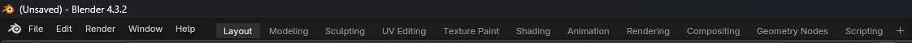
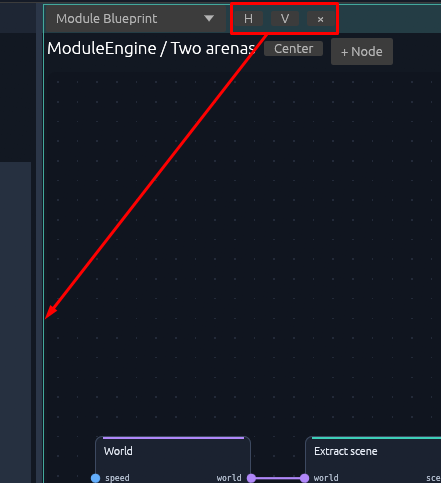
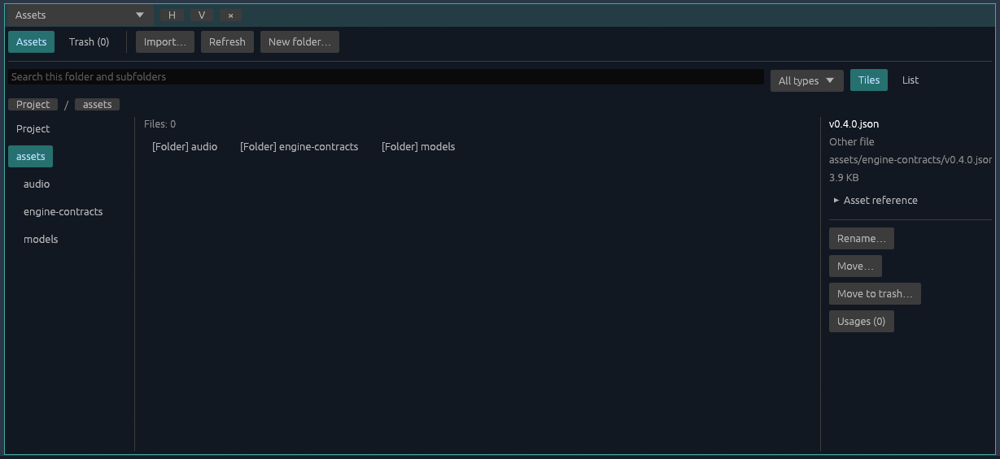

# Понятный редактор: план реализации

[English](../editor-clarity-plan.md) | [Русский](editor-clarity-plan.md) | [Документация](README.md)

## Объём и порядок

13 ноября 2026 пользователь поручил сохранить план и разрешил реализацию
**только этапа 1, пунктов 1.1–1.5**. Следующее поручение разрешает **этап 2,
пункты 2.1–2.5**. Один настраиваемый ModuleEngine обслуживает
несколько игровых проектов. [Принятое направление](engine-composition-direction.md)
определяет ответственность движка/игры, обзор как точку входа и отложенную работу
по нескольким движкам.

Этапы 1 и 2 завершены в пределах записанных проверок и ревью. 14 ноября
пользователь поручил спланировать внедрение нового UI. Новый [этап 2A](#stage-2a)
предшествует работе над рендером; 15 ноября пользователь разрешил его реализацию,
ход которой записан в [отчёте внедрения](editor-ui-rollout.md). Номера и
якоря прежних этапов 1–6 сохраняются. Порядок:
**1 → 2 → 2A → 3 → оставшиеся проверки этапа 4 → 5 → 6**. Первый законченный
маршрут рендера остаётся **Engine → понять состав → Rendering → FXAA/off →
применить → сохранить/открыть**, теперь на новой основе UI. Следующее поручение
по 0.4.1 разрешает этап 3, задачи 3.1–3.6; [реализация и ограниченные инженерные
доказательства](release-041-verification.md) записаны отдельно, а проверка
удобства людьми ещё не выполнена. Этапы 4–6 остаются планом. Нужно
сохранять авторские данные, стабильные ID, точные pins, личные раскладки,
существующие исходники и права Full/Team.

[Дизайн UI/UX](editor-ui-design.md), [техническая база](editor-ui-spec.md)
и [поддерживающие навыки](editor-ui-skills.md) объединяют последующие пожелания
к UI и исследование. Они не реализуют и не разрешают отложенные этапы; точные
размеры — предлагаемая база, нерешённые продуктовые детали остаются открытыми.

Последующий [полный каталог UI](editor-ui-catalog.md) даёт список с трассировкой
и требования/состояния/макеты каждого интерфейса. Прежние открытые детали
раскладок/окон/адреса получили конкретные предлагаемые default для оценки;
ранние записи сохраняют историческую договорённость с пользователем. Это
не разрешает реализацию этапов 3–6 и не меняет приёмку runtime.

## 1. Состав и ответственность

| Задача | Работа и условие завершения |
| --- | --- |
| 1.1 | Составить список настоящих установленных модулей, исполняемых систем, сервисов, библиотек и инструментов редактора по существующим источникам. Зафиксировать наличие и происхождение. |
| 1.2 | Отнести каждую возможность к техническому движку, переиспользуемому игровому слою или конкретному проекту. Различать вид возможности и смыслового владельца; бой и здоровье остаются игровыми. |
| 1.3 | Предоставить понятное название, назначение, зависимости и переходы к настройке для нынешних возможностей собственных пакетов. Не придумывать поведение установленному контракту или библиотеке. |
| 1.4 | Определить доказательства состояний «установлено», «предоставлено профилем» и «участвует». Отличать неизвестные данные от известного пустого множества; авторский выбор не доказывает запуск или готовность экземпляра. |
| 1.5 | Добавить недостающие исходные метаданные рядом с нынешними реестрами. Переиспользовать их правила участия/доступности; просмотр только читает данные и не запускает фабрики, компиляцию или сервисы. |

Завершение: у каждой показываемой нынешней возможности есть назначение,
владелец, прослеживаемый источник наличия/участия и честный маршрут настройки
или явное ограничение. Проверить меньшие составы, отсутствие метаданных,
отклонённое определение активности, отсутствие побочных эффектов и сохранность
авторских документов/pins. До закрытия этапа записать фактический статус
реализации, проверок и ревью.

Реализация этапа 1 и ограниченная проверка завершены; см. [контракт возможностей
и доказательства](engine-capabilities.md#stage1-verification). Независимое ревью
определяет приёмку изученного снимка исходников. Этим закрываются только
пункты 1.1–1.5; этап 2 этим результатом не начинается.

## 2. Обзор Engine

| Задача | Работа и условие завершения |
| --- | --- |
| 2.1 | Добавить окно обзора с доступом из Windows и новой стандартной раскладки Engine; сохранить существующие личные раскладки. |
| 2.2 | Показывать текущую игру/путь, активную конфигурацию и настоящие права редактирования. |
| 2.3 | Отдельно группировать технические подсистемы и игровые пакеты на основе данных этапа 1. |
| 2.4 | Показывать назначение, реализацию, зависимости, состояние и поддержанные действия выбранной возможности. |
| 2.5 | Переходить к настоящему нужному инструменту/графу: активировать существующую область либо открыть её по действующим правилам навигации. |

Завершение: пользователь находит рендер, объясняет его роль и открывает настройку
без чтения исходников. Проверить смену проектов, обновление показанных состояний,
новую/сохранённую раскладку, отсутствующие цели перехода и ограничения Full/Team.

Пункты 2.1–2.5 реализованы. [Контракт обзора и проверки](engine-overview.md#stage2-verification)
фиксируют настоящее окно, ограниченные регрессии, сохранность данных и независимое
заключение с привязкой к исходникам. Настройки рендера этапа 3 этим не начинаются.

## 2A. Внедрение нового нативного UI редактора

**Статус: реализация поставлена; проверки в указанном объёме пройдены.**
Пользователь поручил этап 2A 15 ноября. [Запись внедрения](editor-ui-rollout.md)
содержит фактические Windows/WSLg-проверки, совпадающую поставку и независимое
ревью; границы физических DPI/внешнего ввода/нативных picker указаны явно.
Overview этапа 2 остаётся основой поведения. Работа над возможностями не
переоткрывается, этапы 3/5/6 не начинаются; настройки рендера/подсистем и карта
сохраняют свой отложенный объём.

Цель: пользователь понимает проект/конфигурацию, находит подсистему или объект,
делает разрешённую правку, видит настоящий результат и безопасно сохраняет/
открывает его. Результат — работающий нативный Editor, не viewer статических макетов.

База реализации: [каталог](editor-ui-catalog.md), [общая спецификация](editor-ui-spec.md),
[прототипы иерархии](editor-ui-hierarchy.md), [владение командами](editor-ui-spec.md#command-ownership)
и [ввод графа](editor-ui-spec.md#graph). Defaults прототипов остаются явными
предложениями: **+** копирует текущую раскладку после ввода имени;
переименование/удаление относятся к личным раскладкам; вынесение переносит
область, Close возвращает её; адрес Assets — выделяемый текст той же папки только
для чтения. Поправки нужно отразить в контракте и макете до приёмки реализации.
Одна запись плана не означает приёмку возможности.

Первая поставка ориентирована на Windows Editor, сохраняет сборку Linux и
проверяет доступные существующие Linux-маршруты с настоящими ограничениями.
Новые платформенные сервисы, мобильная поддержка и новая приёмка на аппаратном
Linux вне этого этапа UI; неподдержанный picker остаётся явно неподдержанным.

### Пакет A — безопасная общая основа

| Задача | Результат | Проверка / зависимость |
| --- | --- | --- |
| 2A.1 — объём и исходные замеры | Составить матрицу покрытия по нынешним 72 записям: текущий инструмент, настоящая команда/владелец/права, proposed/deferred-статус, задача реализации и доказательства. Зафиксировать артефакт Editor, характерные раскладки, нагрузки графа/Scene/Playing и доступность исходников. Меню, цели системных picker и образцы не считать 72 новыми окнами. | Изолированные проекты и исходные замеры на неизменном контенте. До тестов проверить полноту Full-фикстур и обязательных исходников; не обходить устаревшие манифесты. Не сбрасывать проект/раскладки пользователя. |
| 2A.2 — общие визуальные элементы | Реализовать отступы/текст/поверхности по ролям, векторные иконки, поля, разделы, выбор/фокус, disabled/busy, семантические имена, подсказки клавиш/причин и переполнение по токенам. Различать факты только для чтения, редактируемые значения, черновики и происхождение. | Проверить настоящие элементы в узких областях и при реальном DPI; без уменьшения текста, состояния только цветом и повторных карточных рамок. Библиотека элементов не запускает отсутствующие runtime-сервисы. После 2A.1. |
| 2A.3 — общие команды и фокус | Направить эквиваленты панели/меню/клавиш в одни существующие команды. Оставить один постоянный пульт в главном каркасе, отдельный Save и настоящие Play/Pause/Stop/Restart по состоянию. Убрать дубли Game и legacy Start/Pause; сохранить отдельный legacy Reset. До графов/overlays определить владельца ввода. | Проверить одинаковые цели, доступность и ошибки из всех входов; текст/popup/модальные окна/границы получают приоритет. Без нового независимого времени preview, дублированных workers и синхронных ожиданий симуляции/GPU. После 2A.1–2A.2. |
| 2A.4 — безопасность черновиков Inspector | Исправить [известный жизненный цикл кеша](editor-ui-hierarchy.md): связать черновики с документом/сценой/объектом/компонентом и совместимыми schema/source, сохранять остальные черновики после Apply компонента и при обычной смене выбора. Замену проекта, удаление или несовместимую схему разрешать явно; недоступный Apply нельзя предлагать рабочим вариантом. | Изменить Actor и Health, применить один, выбрать другой объект и вернуться: остальные авторские значения и черновики сохраняются. Проверить Apply/Discard/Cancel, Undo/Redo, Save/reopen и изоляцию проектов. Пустая правка сохраняет наследование prefab, точные null/неизвестные данные и stable IDs. Нынешние guards сами по себе не доказывают исправление. После 2A.1–2A.3. |

### Пакет B — три эталонных экрана

| Задача | Результат | Проверка / зависимость |
| --- | --- | --- |
| 2A.5 — Engine Overview | Применить иерархию группа/список/подробности P01, маркеры выбора, одно основное контекстное действие и узкий переход в подробности. Сохранить настоящие installed/offered/participating, Unknown и ограничение сведений о готовности runtime. | Найти выбранный рендер и открыть его точный существующий граф без изменения документа и запуска фабрик. Full/Team/отсутствующие исходники работают по прежним правилам. После пакета A. |
| 2A.6 — Inspector | Применить контекст объекта/prefab P08, ограниченные поля Transform, разделы компонентов своих источников, подписи происхождения/черновика и Apply своего компонента. | Использовать исправленный 2A.4; проверить широкий/480-точечный/низкий вид, schema/reference-поля, пустое применение prefab, отсутствие схемы и ограничения Play. Без выдуманного общего Apply. После 2A.4 и 2A.2. |
| 2A.7 — Assets | Применить дерево папок P09, иконки типов, рекурсивный поиск в своей области, результаты/выбор/подробности и режимы readonly-адреса/breadcrumbs. Файловые операции явные и относятся к выбранному ID. | Import/drop/preview; rename/move/trash/restore и usages; защищённые пути, save-first, замена/отвязка, Undo и ошибки. Копирование пути/ссылки сохраняет разницу смыслов. Просмотр не меняет файлы. После пакета A. |

**Первый визуальный рубеж:** эти три настоящие области задают общую иерархию
до переоформления остальных. Проверить отрисованный UI, не только токены или
сходство с SVG. По необходимости уточнять старые компоновки каталога по этим
принципам; не переносить их прежнюю однообразность механически.

### Пакет C — каркас, раскладки и нативные окна

| Задача | Результат | Проверка / зависимость |
| --- | --- | --- |
| 2A.8 — каркас и раскладки | Разместить File/Edit/Tools/Windows, идентичность/путь/права проекта, пульт сессии и Save; сгруппировать окна. Добавить именованные Engine/Project/личные вкладки, **+**, переименование/удаление личных и сброс выбранной по записанным defaults. Хранить личные раскладки обратно совместимо, отдельно от формата авторского проекта. Open/Recent сохраняют защищённые маршруты команд. | Старые личные раскладки загружаются без скрытого сброса; вкладки меняют раскладку, не документ/права. Создать/переключить/сохранить/восстановить после перезапуска, проверить длинные имена, переполнение, Cancel. Drag-перестановка вкладок в этом объёме не обязательна. После пакетов A–B. |
| 2A.9 — управление областями | Заменить H/V/× понятными split/join по ПКМ границы и доступным с клавиатуры меню заголовка. Показывать сохраняемого соседа, безопасно отменять действие. | Выбор границы/графа, оба направления разделения, идентичность сохраняемой области, последняя область, сохранённые area IDs и личный вид. Split/join не становится авторским Undo и не помечает игру изменённой. После 2A.8. |
| 2A.10 — отдельные окна ОС | Сначала исследовать нынешнюю интеграцию окон/рендера, затем реализовать настоящее нативное вынесение: перенос области, общие документ/история/сессия, сохранение вида, закрытие только этого экземпляра; явный Return с безопасным местом, если исходное изменилось. | Настоящее второе окно ОС, фокус/ввод, общие правки/Undo, close/return/restart, отключение монитора и разный DPI. Без подмены floating-панелью или копией проекта/симуляции. Зарегистрированные инструменты сохраняют свой host/state lifecycle. Постоянный пульт остаётся в главном каркасе, клавиши второго окна вызывают те же команды; клиентский заголовок области заменяет File/Edit; заголовок/название/× ОС и нативная рамка размера сохраняются без переключения. После 2A.3 и 2A.9. |

### Пакет D — графы, Scene и Game

| Задача | Результат | Проверка / зависимость |
| --- | --- | --- |
| 2A.11 — ввод графов | Реализовать согласованные жесты своей области: СКМ/ПКМ drag, колесо под курсором без Ctrl, ПКМ Add/действия, двойной щелчок подходящей ноды в существующий подграф, F, Alt+ЛКМ удаления связи и смешанный Delete одним Undo. В root Blueprint нет постоянного ряда Add/Open/Frame/Delete. Дать записанный клавиатурный эквивалент меню. | Порог click/drag, отпускание после pan, пины/встроенные поля, F/Delete холста против текста, модальные окна/границы, выбор, cleanup/Undo, вложенные области и Full/Team. В GPU/gameplay/Rust включать только поддержанные команды; без произвольного редактирования AST Rust. После 2A.3 и 2A.9. |
| 2A.12 — библиотека и помощь нод | Переоформить настоящие палитры модулей/систем и инспекторы нод/ресурсов с фильтром области. Заменить постоянный PIN CONTRACTS справкой у соединения и необязательным справочником типов. | Добавлять только совместимые разрешённые дескрипторы в исходную область-цель; объяснять несовместимость, сохранять последние рабочие связи. Без выдуманных недоступных нод и компиляции от поиска/выбора/pan. После 2A.11. |
| 2A.13 — Scene и Hierarchy | Разместить трансформации на боковой панели, пространство/snap/frame — в компактных overlays; сохранить общий выбор авторского объекта с Hierarchy/Inspector. | Overlay блокирует picking насквозь; move/rotate/scale, world/local/snap, один жест/один Undo, Escape/потеря фокуса, узкий/низкий вид и Save/reopen. Авторская Scene отделена от Game и legacy. После пакета B и 2A.9. |
| 2A.14 — Game и legacy | Использовать команды сессии из каркаса, локальные инструменты вида/состояние Game. Сгруппировать/подписать legacy runtime, сохранить сериализованные типы областей и поддержанные legacy Reset/настройки. | Play/Pause/Restart/Stop, фокус/ввод, разделение author/Play-copy; общий playing root preview, отсутствие второго пульта; открытие старых раскладок/документов. После 2A.3, 2A.8 и 2A.13. |

### Пакет E — покрыть остальные настоящие интерфейсы редактора

| Задача | Результат | Проверка / зависимость |
| --- | --- | --- |
| 2A.15 — остальные инструменты | Применить общие элементы и иерархию задач к нынешним Engine exposure, Project settings, Gameplay Systems, Rust/HLSL, Project File, History/Merge, Diagnostics, Participating Modules и зарегистрированным игровым инструментам. Сохранить явными частичное визуальное покрытие Rust, opaque-фрагменты, состояние source/slot и владельца инструмента. | У каждого текущего инструмента матрицы настоящий доступный вызов/результат либо честная причина недоступности. Сохраняются Save против Apply, exact JSON, область/история, source pins и отсутствие опциональных возможностей. Инструменты проекта G1 не превращаются в обязательные механики движка. После пакетов A–D. |
| 2A.16 — диалоги и переходы | Объединить нынешние modal/merge/recovery-формы, диалоги раскладок и состояние операций. Файловые picker принадлежат ОС, adapter/filter/Cancel сохраняются. Перед защищёнными разрушительными переходами разрешать скрытые черновики инструментов/компонентов. | Несохранённый проект и несколько черновиков, Save As/Open/Recent/close/export, неверные JSON/миграция, отмена/ошибка/recovery и фокус модального окна между общими окнами. Без второго активного фонового пульта и успешной имитации неподдержанного picker. После 2A.4, 2A.8–2A.10 и 2A.15. |

### Пакет F — проверить и поставить

| Задача | Результат | Проверка / зависимость |
| --- | --- | --- |
| 2A.17 — состояние и отзывчивость | Использовать настоящие preparing/applying/ready/error, происхождение last-good и полезную диагностику. Сравнить idle, drag/zoom графа, Scene edits и Playing с 2A.1; убрать измеренные регрессии UI без переделки алгоритмов рендера. | Одинаковые контент/features/разрешение/условия ПК, записанные распределения callback/frame и нагрузка. Без compile/rebuild от навигации, выдуманных процентов, неработающего Cancel и синхронного ожидания GPU/Custom. Прежние бюджеты G1/ARPG/рендера не меняются; шумные/offscreen-результаты не подменяют требуемую приёмку. После реализованных пакетов A–E. |
| 2A.18 — приёмка, документация и поставка | Закрыть матрицу настоящими нативными доказательствами, нужными регрессиями, полной документацией EN/RU и независимым ревью при HEAD/хеше исходников. Собрать соответствующие Editor/исходники и проверить обычный запуск/доступность исходников; не отдавать старый EXE или устаревший Full manifest. | Windows Full/Team/нет исходников/нет опционального модуля, новые/сохранённые раскладки, изоляция проектов/черновиков, нативные окна, error/Cancel/Undo/Save/reopen. Осмотреть рабочие области 1280×720/1600×900/1920×1080 при 100/150/200%, длинные значения, узкие/низкие области. Сборка Linux и доступные native-маршруты — отдельные доказательства; отсутствие Linux picker/аппаратной проверки не превращается в pass. Нативные/GPU-задачи последовательны, замечания исправлены/перепроверены, features Player сохранены. Публикация не подразумевается. После 2A.17 и всех обязательных строк матрицы. |

**Порядок и рубежи:** A → B → C → D → E → F. Задача завершена после проверки
конкретного поведения, отклонения/Cancel и зависимостей; одного скриншота,
скрытой кнопки или успешной сборки недостаточно. Первое поручение на реализацию
может выбрать **2A.1–2A.4**, затем рубеж трёх экранов **2A.5–2A.7**. Этот план
не начинает ни один пакет автоматически.
Перед закрытием каждого существенного пакета реализации обновлять полные
контракты EN/RU и проводить отдельное независимое ревью. Итоговая совместная
проверка 2A.18 не заменяет эти промежуточные проверки.

### Дополнение — отдельные сцены, затем Hierarchy (15 ноября 2026)

Выбранный пользователем порядок: сначала хранение исходников, затем навигация.
Контракт и ограниченные проверки описаны в [файлах сцен](scene-files.md):
загруженные сцены/имена Core, версионированный IO ProjectTools, история
Editor/File/Assets и проекция Full/Team/Player. Затем Hierarchy получает
сворачиваемые строки на всю ширину, поиск, имена/F2 и один объектный Undo.
Обычный Open/Save сохраняет inline-проекты; New/Save As/явное преобразование
пишет внешние файлы. Авторские/личные данные сохраняются. Приёмка требует
error/Cancel/no-op/Undo/Save/повторного открытия, независимости копий, переноса
пакетов, нативной геометрии и независимого ревью. Этап 3 и G2 не начинаются.

### Границы с прежними этапами

| Каталог / прежняя работа | Где остаётся реализация |
| --- | --- |
| Текущие области, виды, диалоги, меню и семейства C01–C04 | Этап 2A реализует настоящий UI и guards. Образцы/цели системных picker не становятся дополнительными самописными окнами ОС. Неизвестные будущие P22-панели регистрируют свой настоящий UI; выдуманный плагин не требуется. |
| V02 настройка рендера и D11 замена пресета | Этап 3 владеет отсутствующей семантикой рендера/exposure и соответствием картинки. 2A оформляет существующие элементы и даёт только настоящие нынешние переходы; без декоративного AA или нереализованной команды пресета. |
| V10 карта архитектуры | Этап 6. Контракт оформления/запись каталога не означает готовую карту или рабочий переход. |
| Настройка возможностей input/audio/world/gameplay | Этап 5 расширяет настоящее обнаружение/настройку. 2A не выдумывает конфигурационный API библиотеки и не включает отсутствующий сервис. |
| Новые игровые/рендерные подсистемы, весь визуальный Rust, G2-редакторы анимации/ИИ, игровой HUD/арт, мобильные порты, несколько движков | Вне 2A; прежняя дорожная карта/решения действуют. Это внедрение UI редактора, не разрешение добавлять эти возможности. |

Не реализовывать прежний этап 4 дважды. Его стабильные номера остаются проверяемыми:

| Прежняя задача | Использовать настоящие доказательства 2A; проверить оставшийся пробел |
| --- | --- |
| 4.1 Scene и Game | 2A.3, 2A.13–2A.14, 2A.18. |
| 4.2 Legacy identities/раскладки | 2A.9–2A.10, 2A.14–2A.15, 2A.18. |
| 4.3 Группы меню Windows | 2A.8, 2A.15, 2A.18. |
| 4.4 Проект/Open/Recent | 2A.8, 2A.16, 2A.18. |
| 4.5 Несохранённость/Cancel/ошибки | 2A.4, 2A.16, 2A.18. |

Эта связь не закрывает этап 4 сегодня. После 2A, при переходе к этапу 4, сверить
доказательства с исходниками/артефактом и закончить только непокрытые критерии.
Отложенные записи ниже сохраняют исторические пожелания; новые defaults
каталога/спецификации и этот этап определяют предложение реализации.

## 3. Законченный маршрут настройки рендера

Это первый рубеж [продуктовой карты](product-roadmap.md#render).
В [задании на 0.4.1](release-041-plan.md) описаны две роли авторов, обычный запуск,
проверка в самостоятельном Player и передача в реализацию.

Реализация и ограниченные инженерные проверки записаны в
[отчёте 0.4.1](release-041-verification.md). Приёмка удобства владельцем и
независимым автором остаётся открытой; эти проверки не начинают этапы 4–6.

| Задача | Работа и условие завершения |
| --- | --- |
| 3.1 | Показывать выбранный путь рендера и существующие проходы, понятно объяснять AO, AA и другие сокращения. |
| 3.2 | Различать архитектуру/разрешённые настройки Engine и значения/готовые варианты, изменяемые Project. |
| 3.3 | Сначала закончить существующий выбор FXAA/off: авторские настройки и настоящее изображение должны соответствовать друг другу. |
| 3.4 | Согласовать панель и граф при удалении/возврате AA/AO; различать отсутствующий проход и выключенный эффект. |
| 3.5 | Показывать настоящие состояния изменения/применения/готовности/ошибки и необходимость Stop либо пересборки до выполнения. Отклонение сохраняет принятую версию. |
| 3.6 | Проверить изменение изображения, Undo/Redo, Save и открытие, отклонение кандидатов и затронутые существующие пути рендера. |

Завершение: настройку AA можно понять, изменить, увидеть и восстановить с диска.
Заявления о поведении изображения требуют настоящих доказательств рендера;
тесты данных их не заменяют. При изменениях runtime применяются существующие
критерии производительности.

## 4. Окна и навигация проектов

| Задача | Работа и условие завершения |
| --- | --- |
| 4.1 | Явно обозначить ответственность Scene для авторства и Game/Play для исполнения. |
| 4.2 | Объяснить и сгруппировать похожие прежние окна, сохранив старые документы, сериализованные идентификаторы областей и раскладки. |
| 4.3 | Сгруппировать Windows по сцене, ресурсам, игровым системам, настройке Engine и диагностике. |
| 4.4 | Сделать текущий проект и доступ к Open/Recent заметными через существующие защищённые команды. |
| 4.5 | Проверить несохранённые переходы, Cancel, ошибки открытия и обновление после смены игры. |

Завершение: понятны область данных каждого окна и путь к другой игре.
Игровая принадлежность не даёт автоматически права менять замороженное
расписание Team. Одна игра не должна получать несохранённое состояние другой.

### Отложенное улучшение UI: именованные вкладки раскладок — 14 ноября 2026

Пользователь попросил верхнюю строку именованных рабочих пространств/раскладок
по образцу Blender и явно отложил реализацию, пока собирает улучшения UI.
Это дополнение к этапу 4; текущий интерфейс не меняется.

- Показывать доступные именованные раскладки вкладками сверху, как на референсе ниже.
- Считать Engine и Project начальными готовыми раскладками; дать возможность
  добавить собственную именованную раскладку через заметную кнопку **+**.
- Каждая раскладка сохраняет расположение и типы своих окон. Пользовательские
  раскладки хранить в личных настройках редактора, сохраняя существующие.
- Переключение раскладок оставляет тот же открытый игровой документ. Название
  раскладки не выдаёт права редактирования Engine и не меняет ограничения Full/Team.

Точный процесс создания раскладки (пустая, копия или выбор готовой), а также
переименование, перестановка и удаление пока не согласованы. Эта запись не
добавляет их в объём реализации.

Будущая проверка: добавить именованную раскладку через **+**, расположить окна,
переключиться между ней и готовыми раскладками, восстановить сохранённые варианты
без изменения проекта, прав и существующего личного расположения окон.

### Отложенное улучшение UI: меню границы областей и внешние окна — 14 ноября 2026

Продолжаем собирать требования; реализация остаётся отложенной. Доступ к текущим
функциям управления областями **H / V / ×** перенести в контекстное меню по
**ПКМ на границе между областями**. Использовать понятные команды разделения
по горизонтали, по вертикали и закрытия/объединения соседних областей с явным
выбором сохраняемого содержимого. Что окончательно делать с дублирующими кнопками
заголовка, пока не определено.

Референс проверен по [официальному руководству Blender 4.3](https://docs.blender.org/manual/en/4.3/interface/window_system/areas.html):
ПКМ на границе предлагает разделение, объединение и обмен областями. Команда
**Duplicate Area into New Window** создаёт ещё одно системное окно того же
экземпляра Blender; исходная область остаётся. Также работает Shift-перетаскивание
угла области. Обмен областями — справочная возможность Blender, а не дополнительно
согласованное требование.

Для ModuleEngine нужна панель редактора в **отдельном системном окне ОС**, которое
можно перенести на другой монитор. Все окна используют один открытый проект,
авторское состояние/историю и прежние права редактирования. Состояние просмотра
и навигации панели сохраняется; нужен способ вернуть её в основную раскладку.
Переносит ли основная команда оригинальную область или создаёт дополнительный
вид, а также точное поведение возврата/закрытия — решения перед реализацией;
вынесение нельзя незаметно подменять дублированием Blender.

Будущая проверка: выбор границы для меню, оба направления разделения,
закрытие/объединение соседей, отмена и сохранённые раскладки; редактирование/фокус
внешнего окна, общие изменения и Undo, другой монитор, возврат/закрытие, права
Full/Team. Эта запись не реализует внешние окна и не меняет заголовки областей.

### Отложенное улучшение UI: управление графом мышью — 14 ноября 2026

Записана последняя поправка пользователя: перемещение вида — **перетаскивание
СКМ или ПКМ**, без ЛКМ. Предыдущее пожелание оставить только СКМ отменено.
Обычные выбор и перетаскивание нод ЛКМ остаются отдельными от перемещения вида.

| Жест внутри графа | Желаемое поведение |
| --- | --- |
| Alt + ЛКМ по связи | Удалить эту связь. |
| Перетаскивание СКМ или ПКМ | Перемещать вид графа. |
| Клик ПКМ по фону графа без перетаскивания | Открыть список доступных нод для текущей области этого графа. |
| Клик ПКМ по ноде без перетаскивания | Открыть меню доступных действий этой ноды. |
| Колёсико без Ctrl | Приближать/отдалять граф относительно курсора. |
| Delete при выделенных нодах/связях | Удалить всё выделение. |

Клик ПКМ отделять от перетаскивания обычным порогом начала drag; после перемещения
отпускание ПКМ не открывает список нод. ПКМ на **границе областей** вместо этого
открывает описанное выше меню управления областями. Список нод учитывает текущий
граф/вложенную область и ограничения Full/Team. Удаление связи использует прежние
Undo/Redo и валидацию; масштаб и перемещение относятся к графу под курсором.

Добавить множественное выделение нод и связей, в том числе смешанное.
Delete удаляет выбранные ноды/связи и соединения удаляемых нод, не оставляя
висящих концов. Весь набор — одна операция Undo/Redo, включая прежнюю очистку
связанных настроек и валидацию. Команду обрабатывает только активный граф;
в текстовом поле Delete удаляет текст. Меню ноды учитывает её тип, поддержанные
операции и текущие права; декоративных или неприменимых команд не предлагать.
Контекстный клик по ноде уточняет поведение ПКМ по фону; обычный ЛКМ по-прежнему
выбирает/перетаскивает ноды.

Будущая проверка: различить клик/drag, удалить и отменить удаление связи,
добавить ноду в нужную область, масштабировать без Ctrl с сохранением точки под
курсором; остальные панели, текстовые поля, перемещение нод и границы сохраняют
свои обработчики ввода. Также проверить действия конкретной ноды, смешанное
выделение, групповое удаление и полное восстановление Undo без затрагивания
другой области или активного текстового поля. Это будущие привязки;
текущая реализация не меняется.

### Отложенное улучшение UI: понятный проводник Assets — 14 ноября 2026

Ориентироваться на визуальные и навигационные решения Project browser в Unity.
Пользователь отметил две конкретные проблемы текущего Assets: путь нельзя
выделить как текстовый адрес, а папки выглядят обычными надписями, не папками.
Реализация остаётся отложенной, пока собираются улучшения UI.

- Сохранить кликабельные части пути — «хлебные крошки», и дать тот же адрес
  выделять/копировать как текст. Это два представления одной текущей папки.
- Сделать папки узнаваемыми по значкам в дереве, Tiles и List.
  В плитках нужен настоящий значок папки с названием, а не только текстовый
  префикс `[Folder]`; в дереве — понятные отступы и состояние раскрытия/сворачивания.
  Отличать папки от файлов не только цветом.
- Сохранить навигацию, поиск/фильтр, превью, импорт, постоянные ID ресурсов,
  ссылки и защиту файловых операций. Это улучшение представления/навигации,
  а не новый формат ассетов или смена корня ресурсов.

[Официальный справочник окна Project в Unity](https://docs.unity3d.com/6000.0/Documentation/Manual/ProjectView.html)
описывает дерево папок и значки типов. Выделение/копирование текстового адреса —
пожелание пользователя; конкретная горячая клавиша Unity не предполагается.
Жест переключения текста/крошек, относительный/абсолютный формат адреса и
ручной ввод пути пока не определены.

Будущая проверка: узнавать папки с первого взгляда, переходить по крошкам,
выделять/копировать ту же текущую папку текстом и менять папки без потери
целостности выбора/ссылок и без изменения файлов от простого просмотра.

### Отложенное улучшение UI: overlays Scene и стандартные иконки — 14 ноября 2026

Пользователь попросил размещать инструменты по краям viewport или плавающими
группами, а стандартные органы управления, включая Play, Stop и Save, делать
узнаваемыми иконками с подсказками. Требования записаны без изменения редактора.

- Scene: боковые инструменты трансформаций и компактные наложенные группы
  пространства координат, привязки и кадрирования с адаптивным переполнением
  и без просачивания ввода в сцену. Сохранить клавиши и жесты/Undo/Cancel.
- Стандартные действия используют иконки, постоянные выбранные/checked-состояния
  и подсказки с настоящей клавишей, эффектом и причиной недоступности. Фокус
  клавиатуры и семантические имена дают равнозначный доступ. Названия модулей,
  неоднозначные/разрушительные варианты сохраняют текст; не все команды icon-only.
- Необъяснённый постоянный подвал `PIN CONTRACTS` библиотеки заменяется
  контекстной справкой соединений и необязательным справочником типов;
  настоящая валидация пинов сохраняется.

[Дизайн](editor-ui-design.md#interaction) и
[техническая спецификация](editor-ui-spec.md#scene) задают причины, предлагаемые
размеры, состояния и проверки. Они также отделяют меняющие документ пресеты
старого 3D Viewport от безобидных настроек вида. Запись не означает приёмки
переноса функций, нативных окон или реализации иконок/overlays.

## 5. Распространение маршрута на остальные существующие возможности

| Задача | Работа и условие завершения |
| --- | --- |
| 5.1 | Подключить существующие возможности ввода и настройки действий; смысл игровых действий оставить отдельному владельцу. |
| 5.2 | Подключить настройку звука, различая нативный сервис и игровые файлы, связи событий/звуков и правила громкости. |
| 5.3 | Подключить инструменты ресурсов/импорта и мира с настоящими поддержанными маршрутами и ограничениями совместимости. |
| 5.4 | Подключить переходы к игровым системам и инструментам пакетов с правильной принадлежностью и правами. |
| 5.5 | Проверить отсутствие опциональных возможностей: нет неявных сервисов, посторонних обязательных настроек и лишних features поставки игры. |

Завершение: нынешние возможности имеют одинаково понятный путь обнаружения,
а действия соответствуют библиотекам, сервисам и исполняемым системам. Этап не
добавляет отсутствующие подсистемы анимации, сети, физики или графические backend.

## 6. Полезная карта архитектуры

| Задача | Работа и условие завершения |
| --- | --- |
| 6.1 | Выбрать конкретные вопросы карты: зависимости и последствия удаления возможности. |
| 6.2 | Получать узлы/связи из настоящих метаданных состава, сохраняя различия принадлежности и неизвестных состояний. |
| 6.3 | Начать с просмотра связей; первая версия только для чтения — рекомендация, а не реализованный редактор. |
| 6.4 | Открывать те же сведения/инструменты, что и обзор, без независимого состояния настройки. |
| 6.5 | Проверить полезность, соответствие выбранной конфигурации и отзывчивость. |

Завершение: карта отвечает на выбранные вопросы и дополняет обзор. Она не
превращает каждую библиотеку/сервис в исполняемый узел и не подразумевает
универсальный исполнитель. Полезность оценивается после работы предыдущих маршрутов.

## Правила завершения каждого этапа

Реализовать ограниченные задачи, проверить настоящее поведение и затронутые
ошибки/отмену, обновить полную документацию EN/RU и провести независимое ревью
с привязкой к HEAD/хешу исходников. Исправить подтверждённые замечания объёма и
перепроверить затронутое. Явно записать оставшиеся ограничения.

Выбирать проверки из [маршрутов верификации](verification.md), сначала изучая
`--plan`; применять целевые регрессии вместо полной suite после каждой мелкой
правки. Нативные/GPU/timing-проверки выполнять последовательно. По необходимости
перепроверять затронутые G1, ARPG и Puzzle. Использовать изолированные фикстуры
и короткие нативные UI-сессии только там, где нужен реальный осмотр интерфейса.
