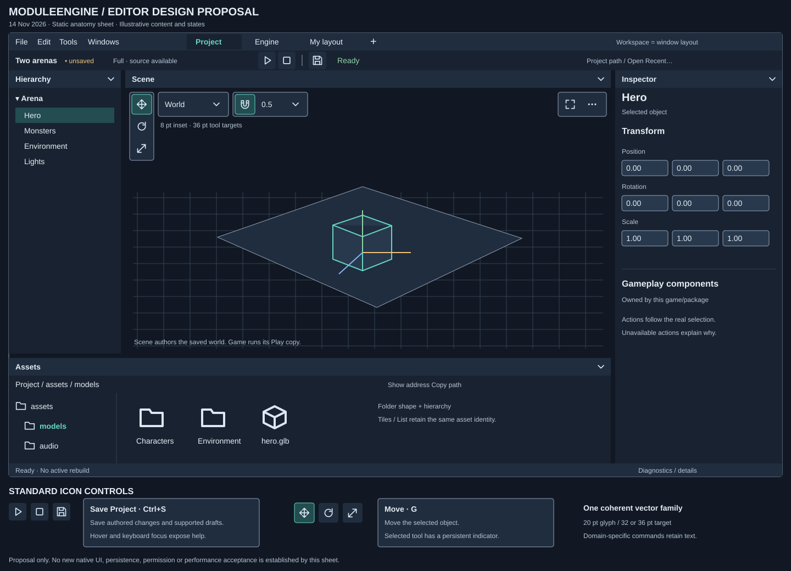

# Дизайн UI/UX редактора

[English](../editor-ui-design.md) | [Русский](editor-ui-design.md) | [Документация](README.md)

## Статус и приоритет правил

Базовый дизайн от **14 ноября 2026 года**. Документ объединяет пожелания
пользователя, аудит исходников и исследование первичных источников. Он предлагает
согласованный интерфейс, но **не реализует его**. [Техническая спецификация](editor-ui-spec.md)
и [токены](../editor-ui-tokens.json) описывают предлагаемые размеры, а не текущий
редактор. Порядок реализации сохраняется в [плане понятного редактора](editor-clarity-plan.md):
этапы 1–2 реализованы в пределах своих доказательств; новый
[этап 2A](editor-clarity-plan.md#stage-2a) выполняется по поручению от 15 ноября;
[настоящее внедрение и доказательства](editor-ui-rollout.md) записаны отдельно.
Этапы 3–6 остаются впереди. Сам дизайн не означает приёмки нативного UI.

Приоритет: последнее указание пользователя, контракты сохранности и прав
проекта, принятое направление, этот дизайн и его техническая база. Если
предложению нужно новое продуктовое решение, оно остаётся явно предложением.
Редакторы-референсы помогают проектированию; их горячие клавиши и правила
сохранения не становятся автоматически требованиями ModuleEngine.

Цель: пользователь понимает выбранный состав движка, открывает настоящие
настройки, делает разрешённую правку и может объяснить текущее состояние.
Параллельно должен быть понятен маршрут редактирования Scene. Вне объёма:
каталог отдельных движков, новые возможности рендера/игры, изменение формата
проекта и косметическое оформление, сохраняющее вводящие в заблуждение или
неработающие элементы управления.

[Полный каталог интерфейсов](editor-ui-catalog.md) дополняет базу списком
по исходникам, требованиями/состояниями каждого окна и диалога, отдельными
макетом и листом состояний для каждой записи. Для конкретного интерфейса
использовать его; этот документ остаётся общим обоснованием, а одна схема
компоновки не выдаётся за дизайн всех окон.

Последующее [уточнение визуальной иерархии](editor-ui-hierarchy.md) меняет
только P01 Overview, P08 Inspector и P09 Assets. Оно разделяет навигацию,
выбор, основное контекстное действие и подтверждающие сведения, добавляя узкие
варианты области. Полнота исходников/ссылок/контраста сама по себе не доказывает
понятность задачи. Остальные компоновки каталога этим уточнением не переработаны.

[Аудит владения командами](editor-ui-spec.md#command-ownership) убирает дубли
жизненного цикла Game и Save в Project File. Общая панель владеет управлением
сессией Game; области сохраняют отдельные операции вида/черновика. У legacy
preview остаются только его Reset/настройки; Start/Pause использует общий флаг
и убран. Поясняющие образцы явно обозначены примерами. Альтернативы меню/горячих
клавиш сохраняются. Это исправление макетов.

Макет root Blueprint также убирает постоянный ряд Add/Open/Frame/Delete. ПКМ
фона, двойной щелчок подходящей ноды, F/Delete сфокусированного холста и
контекстные меню предоставляют те же операции; текст/popup сохраняют приоритет
фокуса. Это целевое управление, не изменение нативной реализации.

## Информационная архитектура

Один настраиваемый ModuleEngine обслуживает несколько игровых проектов.
Интерфейс должен последовательно разделять следующие понятия:

| Понятие | Значение и видимый признак |
| --- | --- |
| Открытый игровой проект | Авторский документ, ресурсы и правила игры. Показывать имя, несохранённые изменения и доступный полный путь. File → Open/Recent меняет проект через существующие защитные проверки. |
| Конфигурация Engine | Технический состав и разрешённые Project изменения в этом документе. Правка не обновляет автоматически все игры. |
| Рабочее пространство | Именованная раскладка областей редактора. Engine и Project — начальные раскладки; смена вкладки сохраняет документ и права. |
| Область инструмента/графа | Что редактирует окно: проходы рендера, игровое расписание, авторскую сцену или старый корневой blueprint. Показывать имя и путь области. |
| Владелец возможности | Технический Engine, переиспользуемый Gameplay или конкретный Project. Бой/здоровье относятся к игровому слою, backend рендера — к техническому движку. |
| Права редактирования | Настоящие ограничения Full/Team и доступности исходников. Название раскладки не выдаёт и не отнимает права. Замороженное расписание Team остаётся замороженным, даже если его владелец — Gameplay. |

Основной маршрут состава: **Engine Overview → подробности подсистемы →
поддерживаемый инструмент**. Графы объясняют и редактируют конкретный процесс.
Карта архитектуры — дополнительное представление связей, а не требование
подключать каждый сервис или библиотеку как исполняемую ноду. Сохранять различия
«установлено/предоставлено/участвует» и неизвестные данные из
[контракта возможностей](engine-capabilities.md).

В Overview технические подсистемы должны быть отделены от игровых
пакетов/содержимого проекта; нужны назначение, текущие доказательства состояния
и один честный маршрут настройки. Недоступное действие с причиной можно
показывать, когда оно помогает обнаружить возможность. Не показывать сетевые
настройки, если выбранный состав не содержит сетевой возможности. Открытие
панели не должно активировать опциональный модуль.

## Текущие проблемы и ответы дизайна

Это наблюдения по текущим исходникам и скриншотам пользователя, а не новая
проверка runtime. Нужные места исходников перечислены в технической спецификации.

| Наблюдаемый интерфейс | Почему непонятно | Предлагаемое решение |
| --- | --- | --- |
| Engine и Project предоставляют многие одинаковые окна. | Названия раскладок выглядят как отдельные документы или режимы доступа. | Сохранить их как начальные именованные раскладки; отдельно показывать документ и настоящие права. |
| Module Library повторяет заголовок “Modules”, показывает номер панели, длинную колонку широких кнопок добавления и `PIN CONTRACTS` под ограниченным по высоте списком. | Смешаны каталог, адрес назначения и техническая справка; нижнее содержимое может обрезаться. | Каталог с поиском по текущей области, понятное назначение, строки списка, контекстная справка и одна прокручиваемая область содержимого. |
| `PIN CONTRACTS` — цветная легенда типов. | Термин не объяснён и оторван от конкретной попытки соединения. | Подсказки/подробности пинов объясняют данные, неверная связь — настоящее несоответствие. Общая легенда доступна по запросу в “Connection types”. |
| Старый 3D Viewport предлагает Objects/ECS и GPU Forward/Deferred рядом с демонстрацией. | Окно просмотра выглядит как второй источник настроек архитектуры. | Показывать текущую конфигурацию и переход к ней; замену пресета позднее вынести в явное действие графа/настроек. |
| В Scene длинная текстовая строка инструментов. | Действия и настройки постоянно занимают место и конкурируют с содержимым. | Боковая панель инструментов и компактные наложенные группы с понятным активным состоянием и меню переполнения. |
| Play, Stop, Save и трансформации представлены текстовыми кнопками. | Стандартные частые действия выглядят громоздко. | Узнаваемые векторные иконки с подсказками, семантическими именами для доступности и эквивалентами в меню. Специфичные команды остаются с текстом. |
| H/V/× есть в каждом заголовке области. | Одиночные буквы не объясняют операции с раскладкой. | Контекстное меню границы с понятными split/join; обнаруживаемое меню заголовка и доступ с клавиатуры. |
| Папки Assets выглядят как текст `[Folder] name`. | Слабо различаются папки/файлы и иерархия. | Пиктограммы папок, раскрытие/отступы дерева, иконки типов; хлебные крошки и выделяемый адрес той же папки. |

`PIN CONTRACTS` означает **контракты пинов/соединений**, а не “Pin constructs”.
Текущая легенда описывает корневые типы (`World`, `Scene3D`, `Frame3D`, `Scalar`)
и GPU-типы (`GpuColor`, `GpuNormals`, `GpuDepth` и т. п.). Это не сам валидатор.
Одинакового цвета пина или общего слова «текстура» недостаточно: настоящий
контракт может также ограничивать смысл данных, формат, размеры или число
сэмплов. Нельзя удалять эту информацию ради упрощённой подписи.

Кнопки старого preview сейчас **изменяют корневой документ**. Выбор GPU-пресета
заменяет подграф выбранного рендера; это не безобидная временная настройка
камеры. При последующем переносе нужно сохранить старые документы/ID окон и
явно показать замену с потерей прежней настройки и Undo. Удаление/переименование
этого окна данным запросом на дизайн не согласовано.

## Исследование референсов и выводы

Первичная документация изучена 14 ноября 2026 года. Это ограниченное сравнение
приёмов, а не пользовательское тестирование или копирование пиксельных размеров.

| Референс и наблюдаемый приём | Применение в ModuleEngine | Ограничение |
| --- | --- | --- |
| [Blender 4.3 Workspaces](https://docs.blender.org/manual/en/4.3/interface/window_system/workspaces.html): верхние вкладки обозначают раскладки областей под задачи; + добавляет рабочее пространство. | Именованные вкладки и видимое добавление делают смену раскладки понятной. | Blender может сохранять рабочие пространства в документе; ModuleEngine сохраняет личное хранение раскладок и собственные проверки смены проекта. |
| [Blender 4.3 Areas](https://docs.blender.org/manual/en/4.3/interface/window_system/areas.html): контекстные действия на границе управляют разделением/объединением; “Duplicate Area into New Window” создаёт ещё одно окно того же экземпляра. | Операции раскладки размещаются на границах; поддерживается настоящее дополнительное окно ОС. | Дублирование Blender не означает вынос/перемещение исходной области. Точная политика move/duplicate ModuleEngine ещё открыта. |
| [Unity 6.0 Project window](https://docs.unity.com/en-us/engine/6000.0/manual/unity-editor/editor-windows-views-reference/project-view): дерево папок и иконки типов помогают искать ресурсы. | Пиктограммы папок, структура дерева и единая идентичность в Tiles/List. | Выделяемый текст адреса — требование пользователя; источник не определяет точный жест для него. |
| [Unity 6.0 Overlays](https://docs.unity.com/en-us/engine/6000.0/manual/working-with-scenes/scenes-manage-gameobjects/overlays): инструменты Scene находятся в настраиваемых панелях с контекстной информацией. | Группировать инструменты Scene рядом с областью просмотра вместо одной большой строки настроек. | Произвольное перетаскивание overlays не обязательно для первой базовой версии. |
| [Unreal 5.6 Viewport Toolbar](https://dev.epicgames.com/documentation/en-us/unreal-engine/viewport-toolbar?application_version=5.6): группы transform/snap/camera и переполнение в небольших окнах. | Постоянные места инструментов, группы настроек и явное меню переполнения. | Unreal описывает панель над viewport. Наше размещение поверх изображения/у края — выбор дизайна, а не точная копия. |
| [Unreal Blueprint Graph Editor](https://dev.epicgames.com/documentation/unreal-engine/graph-editor-for-the-blueprints-visual-scripting-editor-in-unreal-engine): перетаскивание ПКМ двигает граф, колесо масштабирует, щелчок открывает меню. [Добавление нод](https://dev.epicgames.com/documentation/unreal-engine/placing-nodes-in-unreal-engine?lang=en-US) использует контекстный поиск. | Знакомое управление графом и каталог по текущей области. | Сохранить окончательные пожелания пользователя: перемещение СКМ или ПКМ, Alt+ЛКМ удаляет **связь**. Не переносить семантику Alt-click по пину из Unreal. |

Эти приёмы поддерживают согласованную гипотезу: стабильная раскладка, инструменты
по контексту и постепенное раскрытие подробностей должны уменьшить текущую
путаницу. Они не доказывают удобство предложенного экрана. Перед приёмкой
реализации проверить настоящий маршрут задачи; если пользователи всё ещё не
могут объяснить, что меняют, сократить маршрут или пересмотреть подписи.

Внутренние ориентиры читаемости: [контраст текста W3C](https://www.w3.org/WAI/WCAG22/Understanding/contrast-minimum.html),
[нетекстовый контраст](https://www.w3.org/WAI/WCAG22/Understanding/non-text-contrast.html)
и [подсказки при наведении/фокусе](https://www.w3.org/WAI/WCAG22/Understanding/content-on-hover-or-focus.html).
Адаптированные пороги заданы в спецификации. Это не заявление о соответствии
нативного desktop-приложения WCAG.

## Правила взаимодействия и содержимого

**Иконки.** Play/Pause, Stop, Save, Move, Rotate, Scale, кадрирование и привязка —
стандартные действия: использовать одно согласованное семейство векторов с
узнаваемой формой. Подсказки называют действие, настоящую назначенную клавишу,
эффект и причину недоступности. Выбранный инструмент сохраняет явный индикатор
активности. Фокус с клавиатуры даёт равнозначную справку; каждая иконка имеет
семантическое имя для доступности. В меню остаются понятные подписи. Названия
модулей, виды графов, варианты Apply/пересборки/экспорта и подтверждения
разрушительных действий требуют текста: замена всех слов иконками усложнит
обнаружение. Не добавлять декоративные команды без поведения.

**Scene.** Трансформации — на левой боковой панели, пространство координат и
привязка — компактными группами сверху, кадрирование — справа сверху. Это
наложение поверх изображения, а не объекты сцены. Элементы поглощают свой ввод,
не выбирают объект и не начинают перетаскивание манипулятора под ними. В узком
окне второстепенные настройки уходят в подписанное меню переполнения. Сохранить
G/R/S/F и существующие правила одного объекта, world/local, привязки, Escape
и одного Undo на законченный жест.

**Графы.** Сохранить окончательные жесты пользователя: СКМ/ПКМ с перетаскиванием
двигает вид; щелчок ПКМ по фону ищет/добавляет ноды; по ноде — открывает её
доступные действия; колесо без Ctrl масштабирует под курсором; Alt+ЛКМ по связи
удаляет её. Смешанное выделение нод/связей с Delete — одна операция документа,
включая прилегающие связи и очистку связанных настроек. В текстовом фокусе
редактируется текст. Спецификация задаёт приоритет щелчка/перетаскивания/границы;
она не добавляет неподдерживаемые виды графов.

**Assets.** Сохранить стабильные ID, защиту импорта/ссылок/файловых операций и
режимы Tiles/List. Крошки и текст адреса обозначают одну папку. Навигация не
переименовывает файлы и не переписывает ссылки. Папка узнаётся по форме и
иерархии, а не только цвету. Узкий вид может скрыть подробности, но не текущий
путь и не доступ к действиям выбранного ресурса.

**Окна.** Меню границы показывает, содержимое какой соседней области сохранится
при объединении; перед применением есть предпросмотр и Escape/Cancel.
Дополнительные окна разделяют документ/историю/права, но хранят собственный вид.
Docking/закрытие области не закрывает проект и не теряет несохранённый документ.
Нельзя обходить Team или выдавать встроенную плавающую панель за окно ОС.

**Обратная связь.** Различать несохранённость проекта, черновик, применённую/
работающую ревизию и состояние операции. “Saved” не означает “applied”. Подготовка,
компиляция, очередь, готовность и ошибка отражают настоящие состояния; без
измеримого процента нужен неопределённый индикатор. Сохранённый последний
рабочий кадр при ошибке должен быть подписан. Cancel доступен только при
настоящей возможности отмены. Подробный вывод компилятора раскрывается и
выделяется; полный лог поверх основной сцены не должен быть единственным
объяснением ошибки.

## Маршруты задач и приёмка

| ID | Что показать в будущей реализации |
| --- | --- |
| UX-01 | Открыть настоящий проект, определить путь/несохранённость/права, открыть Engine Overview, найти рендер и перейти к настоящей настройке. Объяснить, что смена раскладки не меняет проект. |
| UX-02 | Изменить поддерживаемое AA или восстановить/удалить проход в правильной области; увидеть applying/ready/error, изображение, Undo, Save и повторное открытие. Неверный кандидат сохраняет последнюю рабочую версию. |
| UX-03 | Переключить Engine/Project/свою раскладку и восстановить личное расположение. Добавить именованное пространство через + без изменения проекта/прав. |
| UX-04 | Разделить/объединить через границу, безопасно отменить, использовать дополнительное нативное окно и вернуть его. Проверить общие правки/Undo, отдельный вид и фокус между мониторами. |
| UX-05 | Перемещать вид без меню при отпускании; добавить в правильный граф, изучить несовпадение пинов, масштабировать под курсором и удалить/отменить смешанное выделение. Delete в текстовом поле остаётся текстовой правкой. |
| UX-06 | Узнать папки, перейти/найти, скопировать текущий адрес, импортировать/перетащить ресурс и сохранить защиту ссылок/файловых операций. |
| UX-07 | Выбрать/переместить/повернуть/масштабировать объект через иконки, проверить справку с клавиатуры и причины недоступности, отменить жест и вернуть его одним Undo. Ввод через overlay не просачивается в сцену. |
| UX-08 | Пройти затронутые маршруты без опциональных модулей, с Team, ошибками, узкими областями и масштабом 100/150/200%. Нет ложной готовности и обрезанного критичного действия. |

[Технический список проверок](editor-ui-spec.md#verification) задаёт проверки
геометрии, ввода и доказательств. Скриншот подтверждает внешний вид при данном
масштабе, но не сохранение, права, производительность или работоспособность команд.

## Предлагаемые решения и разрешение реализации

Каталог конкретизирует следующие варианты для оценки дизайна. Это предлагаемое
поведение, не заявление о согласии пользователя или выполненной реализации:

| Решение | Рекомендация и следствие |
| --- | --- |
| Что создаёт + | [D08–D10](editor-ui-dialogs.md#d08): имя и копия текущей раскладки либо доступный пресет; rename/delete только личных раскладок со стабильными ID и личным сохранением. [D12](editor-ui-dialogs.md#d12) проверяет целевой сброс. |
| Политика внешней области | [S02](editor-ui-windows.md#s02): Move to New Window сохраняет один лист. У каждого плавающего хоста дерево разбиений и общее меню Area; Split/выбор типа сохраняют принадлежность хосту. Area Close удаляет лист, системный × закрывает текущие листы хоста; явный перенос выполняет docking, команды Return нет. ID/состояние видов и проект сохраняются. Дублирование вне базы. |
| Работа с адресом | [P09](editor-ui-windows.md#p09): Show address переключает выделяемый read-only путь относительно проекта; Copy absolute path явно. Escape/потеря фокуса возвращают крошки; ручной переход вне объёма. |
| Старый preview | [P17–P19](editor-ui-windows.md#p17) сохраняют подписи/ID в отдельной legacy-группе. [D11](editor-ui-dialogs.md#d11) делает замену пресета явной. Удаление не предлагается. |
| Настройка overlays | Сначала разумные фиксированные места и адаптивное переполнение; свободное перетаскивание/пресеты — позже, если нужны пользователям. |
| Набор иконок | Общая собственная векторная геометрия каталога; не добавляются сторонняя зависимость иконок, шрифт или лицензия. |

## Реализация и сопровождение

Использовать сохранённый план, не параллельную перепись. Новый
[этап 2A](editor-clarity-plan.md#stage-2a) внедряет общие элементы UI, раскладки,
управление областями, понятные окна и состояние операций ограниченными пакетами.
Общие правила иконок/отступов/overlays применять в этих пакетах. Затем этап 3
завершает недостающую семантику настройки рендера и проверяет настоящую картинку/
результат. Этап 4 использует привязанные к исходникам доказательства 2A и
проверяет только непокрытые критерии навигации/сохранности. Этап 5 расширяет
обнаружение существующих возможностей, этап 6 проверяет карту архитектуры.
Каждой реализации нужны своё разрешение и доказательства приёмки; этот документ
и план этапа 2A — проектные материалы для оценки.

Поддерживать дизайн через [$moduleengine-ui-design](../skills/moduleengine-ui-design/SKILL.md),
проверять изменения через [$moduleengine-ui-review](../skills/moduleengine-ui-review/SKILL.md).
[Установка и использование](editor-ui-skills.md) описаны отдельно.
Это навыки для ModuleEngine, а не модули runtime. Их применение соблюдает реальный
запрос: анализ остаётся анализом, явная реализация разрешает только указанный
объём. Навык ревью не заменяет отдельного независимого проверяющего для
существенных изменений.

Векторная схема показывает предлагаемую геометрию и подход к иконкам. Это
статический проектный артефакт; подписи и состояния операций — примеры, а не
новые доказательства работы продукта.
